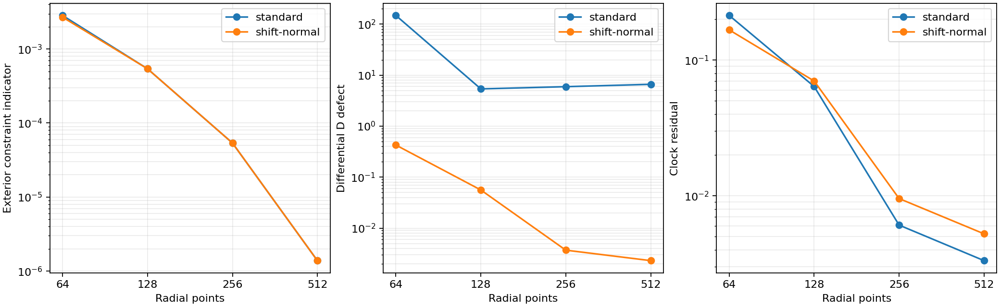
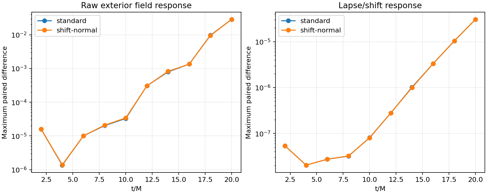
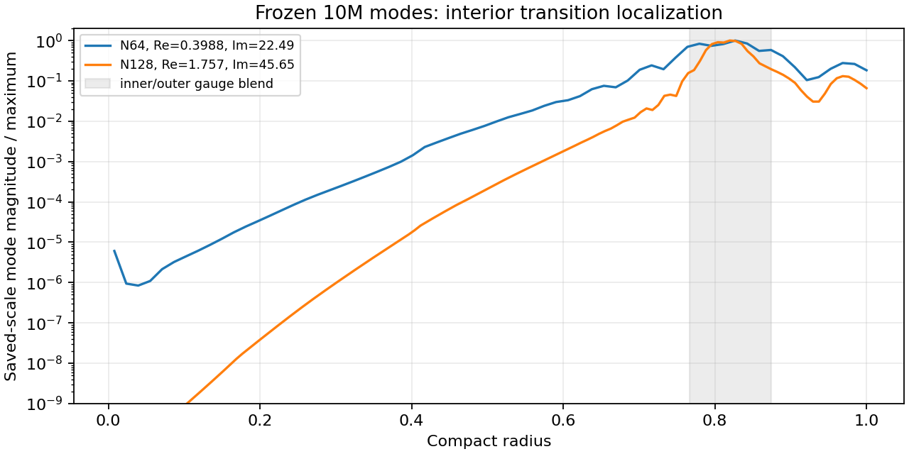

# Outgoing auxiliary trace with a shift normal condition

This experimental spatial policy substantially reduces the differential D
boundary defect while preserving the measured exterior convergence. It does
**not** remove the late gauge response, and no candidate or robust timestep is
admitted. The underlying shared C++ equations and default Python RHS are
unchanged; bitwise default-RHS checks are preserved.

## Numerical policy and checks

The outgoing auxiliary combination C=D−Lambda satisfies
`C_t = beta C_r - kappa_D D`. The boundary C value is extrapolated from five
interior values, retaining independent Lambda. The fixed clock value alpha=1
and null shift value remain as in the standard boundary chart. Only beta's
normal derivative is solved from the **actual shared** shift/null/dependent-D
equation. Its degree-seven Hermite correction vanishes at seven nodal values
and modifies the last three shift derivative rows. Lapse derivatives retain
their original stencils. Clock and differential D residuals are diagnostics;
they are not projected to zero. No bulk D smoothing, Hamiltonian/momentum
solve, Theta/Z reset, floor or elliptic reduction is used.

This removes the extra lapse-normal condition in the rejected coupled policy.
It is motivated by the outgoing C transport and the incoming longitudinal
shift branch of the interior symbol, not by an endpoint hyperbolicity proof.
The singular scri limit still needs its own compatibility/convergence checks.

A changing-geometry fixture preserves the cubic outgoing C trace to roundoff,
leaves lapse jets and independent Lambda/Theta untouched, and matches the
unprojected shared shift rate to its null projection within 5.0e-10. The null
time derivative vanishes. The arbitrary off-constraint fixture has a large
clock residual (75.2), explicitly retained; it does not satisfy regular scri
data conditions. The first test attempt omitted the shift restoring pole
normal from its comparison because that component is not returned by the
analytic geometric/lapse-normal ABI. The failed script and explanation are
retained; the corrected test differentiates the shared shift pole independently.
No evolution was changed to make that test pass.

Initial frozen operators have maximum real eigenvalues 1.2894 at N32 and
.64517 at N64, rather than the coupled closure's grid-scaled 121.45/247.70
mode. These smaller positive values still preclude a contractivity claim.
The N64 initial and evolved 1M/10M matrices, two finite-difference increments,
RK4 polynomials and scaled nonnormal norms are saved. Their exact-flow norms
also amplify perturbations; completion alone is not stability.

## Resolution and timestep evidence

All four resolutions complete 10M without floors at target characteristic
CFL .4. The actual maximum is .400264 at N64 and below .400017 otherwise.
The maximum initial speed is 2.41421356, not one. An earlier three-resolution
control also completes at the retained scri-policy limit C≈.15451.

| Points | Exterior constraint indicator | Differential D defect | Clock residual |
|---|---:|---:|---:|
| 64 | .00268984 | −.425468 | −.166961 |
| 128 | .000540593 | .0559941 | −.0701277 |
| 256 | .0000537247 | −.00369933 | −.00954271 |
| 512 | .00000138386 | −.00230548 | −.00524427 |

The exterior indicator uses the established dimensionless physical
H/M/Theta/Z log-R RMS over reference R/M25–100. Three directional time probes
agree on each D defect. The standard closure's N512 defect is 6.60158, but
the new two-finest decrease is slow and is insufficient to claim qualified
boundary convergence. Clock and pole residuals likewise remain material.

At N64, characteristic CFL .4/.2/.1 gives resolved all-field temporal ratios
corresponding to orders 4.007–4.189. The largest common-exterior field difference
decreases from 1.249e-7 to 7.542e-9. The matched-CFL N64/128/256/512 field
self-differences give finest adjacent log2 ratios 3.54–5.08; Khat, Lambda and D
are close to four. Interpolation sensitivity is saved. These results support
exterior accuracy but do not override boundary or late-response failures.



The full 26-variable radial/transverse/oblique interior point symbols were
rechecked on 11 states of the N512 run through 10M. No defective numerical
cluster is found in the samples; maximum imaginary part is 6.27e-16 and
maximum eigenspace condition number 3.65e5. This does not establish endpoint
uniformity, nonspherical evolution or boosted/3D stability.

## Late response and interior mode

The paired N128 smooth gauge pulse, amplitude 1e-5, completes 20M at C=.4.
Its final maximum raw exterior field response is .02854896, essentially the
same as .02854785 with the standard boundary at C=.5. The earlier standard
.5/.25 time refinement already showed that growth is not an RK artifact.
The new lapse/shift response is 3.0616e-5. Sources and reference fields remain
unperturbed. Raw field and characteristic-space norms are not energies or
pure boundary-reflection coefficients; the initial pulse has both directions.



The leading frozen 10M mode is now localized in the inner/outer gauge blend,
not the endpoint. At N64 its eigenvalue is `.39877 ±22.49066i` and its
scaled amplitude peaks at r=.82677. At N128 it is `1.75743 ±45.65024i`, with
scaled peak r=.81961. The increase of real part and frequency with resolution
is a new warning about the discrete transition operator. It does not by itself
prove a continuum instability; it motivates comparing discrete and continuum
symbols, derivative compatibility and coefficient-gradient effects before
another gauge-profile change or a larger advertised CFL.



## Reproduction and next gate

The runtime options are `--outflow-boundary --boundary-normal-system shift`
with `--chi-reference-power 2`, algebraic chart, analytic normal and reference
jets. Defaults retain the original closure. Each immutable run archives its
complete command/configuration, source identities and raw states. Reproduce
the new checks/plots in fresh destinations:

```
build-spherical/python/bin/python tst/spherical_optimization/test_shift_normal.py \
  --library build-spherical-v18/libcurrent_spherical.dylib --output fresh-boundary-test
build-spherical/python/bin/python tst/spherical_optimization/analyze_boundary_progress.py \
  --evidence docs/spherical-optimization/evidence --output fresh-boundary-progress
```

Before admission: distinguish the interior mode's discretization and continuum
sources; test pulse response under spatial refinement and longer time;
qualify clock/null/auxiliary regularity together; then repeat RK4 limit/margin
and controlled fixed-error cost measurements. Current runs with overlapping
analysis jobs are not controlled cost comparisons. No Aurora jobs were launched
and the parent campaign remains untouched.
