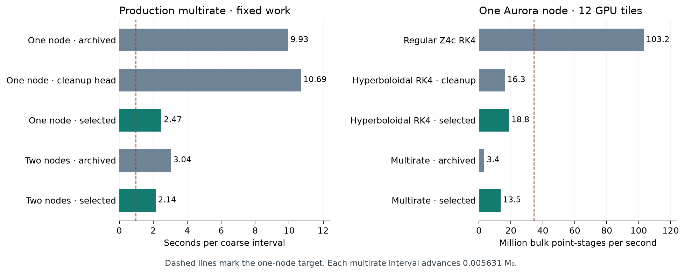

# Single-node N12 hyperboloidal Z4c performance on Aurora

The production multirate calculation advanced 33,467,904 bulk point-stages in **2.474 s** on one node, 4.01× faster than the archived result. It reached 13.53 million point-stages/s, 7.63× below regular Z4c. Reaching the 0.973 s target would require a further 2.54× speedup. The single two-node verification took **2.139 s**, 1.42× faster than the two-node archive.

| Production multirate | s/coarse interval | Million bulk point-stages/s | s/M₀ |
|---|---:|---:|---:|
| Archived one node | 9.9269 | 3.37 | 1,763.0 |
| Cleanup head, one node, archived map | 10.6874 | 3.13 | 1,898.1 |
| Selected, one node, archived map | 2.4979 | 13.40 | 443.6 |
| Selected, one node, automatic map | 2.4745 | 13.53 | 439.5 |
| Archived two nodes | 3.0353 | 11.03 | 539.1 |
| Selected, two nodes, archived 24-rank map | 2.1394 | 15.64 | 380.0 |

Counting one completed four-stage RK update of one bulk zone as a zone-cycle gives 3.381 million zone-cycles/s on one node and 3.911 million/s on two, with every substep included. Extending these output-off warm rates to 100 M₀ gives 12.21 node-hours on one node or 21.11 node-hours on two. Scheduled output, startup, restart and allocation overhead would add to these projections. For historical context, the previous N12 trajectory reached 120.000651 M₀ at cycle 85,208. Its 14 successful two-node production segments used 24.04 node-hours in PBS, or 24.28 node-hours including the failed first launch. That trajectory used its own executable and timestep.

Doubling the node count sped up the selected production interval by 1.16× (57.8% strong-scaling efficiency). The two-node verification used the archived map without two-node tuning. The final one-node automatic-placement run had four-interval means of 2.477, 2.478, 2.468 s. The selected executable also ran uniform hyperboloidal RK4 in 0.3055 s per fine step (18.77 million point-stages/s, 868.0 s/M₀). Applying that uniform rate to the fixed reference workload gives 1.783 s. Closing the entire normalized gap to the selected uniform path would still leave the one-node target out of reach. The production multirate hierarchy uses fewer point-stages per unit of physical time. The earlier 586.37 s/M₀ qualification included scheduled output on two nodes over 222 intervals. It has a different timing window and output workload from the output-off rates above.

## Timing protocol

The production mesh has 754 blocks, 1,433,376 active bulk points and 864 independent surface points. Each coarse interval advances 0.0018768768768768769 code-time units, or 0.00563063063063 M₀. The fixed workload is 18,160 block stages and 33,467,904 bulk point-stages per interval. Every completed multirate run reported the same work at each level. The fixed-work target was 0.973 s/interval.

Uninstrumented timings use solver clocks for cycles 9 through 20 after eight warm intervals. Periodic science output was off. The confirmation jobs saved shared checkpoints outside the timing window. The ownership maps include noncontiguous global block IDs, which require a shared restart file in this implementation. Each node used 12 MPI ranks on the 12 GPU tiles with the archived CPU binding, GPU-aware MPICH and the production oneAPI 2025.3.1 build settings.

## Where the original deficit came from

Regular Cartesian RK4 took 0.04881 s for 5,038,848 point-stages, or 103.2 million/s. The ordinary Cartesian bulk RHS itself occupied 0.01183 s/tile per RK4 step in a separate device trace. Uniform-step hyperboloidal RK4 at the cleanup head took 0.35217 s per fine step, or 16.28 million/s and 1,001 s/M₀. At the fixed multirate work count the regular and uniform hyperboloidal throughputs correspond to 0.324 and 2.056 s. The cleanup-head multirate implementation on the archived block map took 10.687 s. Those three values separate a 1.73 s uniform-formulation difference and an additional 8.63 s associated with executing the multirate workload. They are normalized wall-time comparisons between different workloads.

A separately instrumented production interval on the original map took 10.506 s. Mean Level Zero device service was 2.220 s/tile, with individual tiles spanning 1.607–3.086 s. The ordinary bulk point kernel accounted for 1.000 s/tile and the radial-capable point kernel for 0.149 s. Field-jet derivatives used 0.062 s, dissipation 0.055 s, accepted and stage projection 0.255 s combined, mapped halo interpolation 0.156 s and donor reconstruction 0.105 s. Overlap agreement evaluation and the corresponding RHS update used 0.086 s/tile. Scri projection, sampling, compatibility solve, evaluation and radial preparation used 0.189 s/tile averaged over the node, concentrated on the surface owners. A separately fenced point-level probe on 28.77 million Cartesian point-stages attributed 22 ns/point to field derivatives, 137 to reference restoration and chart expansion, and 172 to point equations. The corresponding ordinary spherical measurements were 33, 269 and 381 ns/point. These probe times include host launch and fence costs.

The recorded dependency chain reconstructed a 10.696 s interval within a 51 µs clock bound. It accumulated 6.553 s between computed readiness and observation of a remote record, 0.046 s ending in a local observation and 0.603 s between observation and dispatch. The bulk RHS contributed 2.153 s on that chain, surface work 0.195 s, donors 0.247 s, agreement 0.132 s and the final drain 0.523 s. Host critical-path phases and tile service overlap. Keeping the recorded dispatch order and eliminating post-readiness delay gave a modeled 4.931 s. Substituting large-batch throughput as well gave 3.781 s. The replay attributes exposed dependency cost without assigning the entire delay to the network.

## Changes tested on one node

On the same folded block map, sharing the already evaluated metric geometry gave 10.228 s. Adding a stable 96 MiB Kokkos allocation for outgoing MPI packets gave 2.878 s, reproduced on a second allocation. Both runs sent 10.466 GB in 13,754 messages. Level Zero copy submissions fell from 55,600 to 3,656 per rank per interval and event-status queries fell from 370,962 to 26,649. Time in IPC handle open, get and close calls totaled about 2 ms/rank before the change. The speedup is associated with the changed copy and polling behavior. The trace cannot apportion all time inside MPI.

A second host measured 10.598 s at the cleanup head, 3.072 s with only the send-pool change and 2.998 s with preallocated receive and owned stage buffers as well. Directly inverting constant-input metrics at projection gave 2.897 s. Experiments also covered multi-packet gather, streaming connection derivatives, staged metric and reference restoration, separate radial and ordinary field derivatives, and combining Cartesian tensor corrections. The full-interval results distinguished local kernel improvements from reductions on the dependency chain. A dedicated MPI progress thread completed zero intervals in 217 seconds under the production rank binding. The final transport uses portable Kokkos views and standard MPI on the calling thread.

Initial automatic compaction put all 24 fastest blocks and all six scri faces on one tile. After send preallocation that tile recorded 3.742 s of service in a 3.910 s traced interval. Other tiles averaged 1.362 s. A short review using measured batch costs retained the compacted map, giving 3.441 s. The grid-derived alternative distributed two fastest blocks per tile and the six surface faces across six tiles. It took 2.653 s with the same executable that took 2.690 s on the archived map. Automatic placement now uses this distribution when the finest level contains scri and has enough blocks for the rank count. The partitioner still scores candidates using block work and donor traffic.

## Final selection and remaining cost

Both clean candidates reused outgoing and incoming Kokkos packet storage, evaluated conformal geometry once, and combined ready blocks of different chart classes at a common local level and RK stage. Scri operations still run on batches containing surface blocks. Shared transport handles packet lifetime and bounds. The Z4c module owns its stage preparation, conformal equations and scri treatment. The cost model records the surface closure time for mixed batches and distributes remaining RHS cost by owned work. The automatic one-node placement reproduced the frozen comparison map exactly.

The base candidate took 2.6504 s and the candidate with additional owned RK buffers and simplified constant-metric projection took 2.4667 s on the same node. The predeclared selection allowance was 0.0205 s, the larger of the repeat difference and the range of four-interval means within either run. The separate owned-record pool and value-only metric projection cleared the measured variation and are included.

A separate unitrace run of the selected executable measured 2.456 s/interval, with 1.782 s mean device service per tile (range 1.012–2.398). Across 12 tiles the measured device service totals 21.39 tile-seconds per interval. Under the current serial submission pattern on each tile, a 0.973 s interval allows 11.68 tile-seconds across the node. Perfect redistribution under that assumption would still need a 45% cut in aggregate device service at these kernel rates. On the busiest tile the ordinary and radial-capable point kernels alone consumed 0.574 and 0.421 s, followed by the surface solve (0.207 s), overlap agreement RHS (0.183 s), donor reconstruction (0.171 s) and mapped halo (0.166 s). Its service and the host waits overlap. The difference between the uninstrumented wall time and tile service from a different run cannot provide an exact MPI wait measurement.

| Most expensive final kernel families | Mean device s/tile/interval |
|---|---:|
| `z4c_hyperboloidal::Z4cHyperboloidal::CalcRHS / ordinary point RHS` | 0.630 |
| `z4c_hyperboloidal::Z4cHyperboloidal::CalcRHS / endpoint point RHS` | 0.214 |
| `z4c_hyperboloidal::MappedHalo::Fill` | 0.154 |
| `z4c_hyperboloidal::MultirateEvolution::Impl::StageDonors` | 0.105 |
| `z4c_hyperboloidal::SurfaceExchange::Solve` | 0.103 |
| `z4c_hyperboloidal::MultirateEvolution::Impl::Reconstruct<true>` | 0.097 |
| `z4c_hyperboloidal::SurfaceExchange::Evaluate` | 0.074 |
| `z4c_hyperboloidal::MultirateEvolution::Impl::Reconstruct<false>` | 0.067 |

## Correctness and scope

The one- and two-node checkpoint comparisons used the cleanup-head checkpoint from job 9103057 at cycle 21, t/M₀ = 0.1182432432. Stable block IDs, topology, atlas, physical identity, timestep and endpoint time agreed. The comparisons scanned 139,683,024 accepted-field scalars and eight persistent diagnostics per record point, including finite-value checks. The maximum scaled difference uses the larger of 1 and the two absolute field values as its denominator. The acceptance bound was 1e−11.

| Compared with cleanup head | Maximum accepted | RMS accepted | Maximum persistent |
|---|---:|---:|---:|
| One node | 1.774e-12 | 4.787e-15 | 1.554e-15 |
| Two nodes | 1.774e-12 | 4.787e-15 | 1.554e-15 |

The selected one- and two-node checkpoint payloads were bitwise identical.

Native two-rank CPU smoke and same-schedule restart passed. The grouped adaptive test refined and coarsened, retained bitwise restart agreement across 7,458,048 scalars, and agreed with its uniform fine reference to 1.776e-15. The radial temporal convergence orders for the two successive refinements were bulk 4.09/4.09, interface 4.03/4.01, and scri 4.21/4.19. The Aurora production target and the native CPU executable both rebuilt. The repository style command ran once. Its C++ and Python checks both failed on existing diagnostics, with zero C++ diagnostics on lines added or modified relative to the cleanup head (5617d14bc). The Python check also traversed existing build trees. No Python source changed in the solver. The original tensor, clock, Bondi and long science records are inherited evidence for unchanged diagnostics and output. The short measurements do not establish long-time trajectory agreement.

The selected solver source is `6d663bc20f080c6ed1696fd7371c9b2d0ecfba9c`. Aurora jobs 9103299 and 9103361 used executable SHA-256 `30cfb1cbbee26ff8a401ce4616d490e0c4e2437ee5a226fa112291e14948d36f`. The campaign archive `n12-single-node-deficit-20261118` contains the input decks, launch commands, per-interval receipts, endpoint comparison, rank-level traces, finalist decision and plot. See the [baseline profile and dependency replay](evidence/n12-one-node-fixed-work.json) and the [final receipts](evidence/n12-one-node-confirmation.json).
