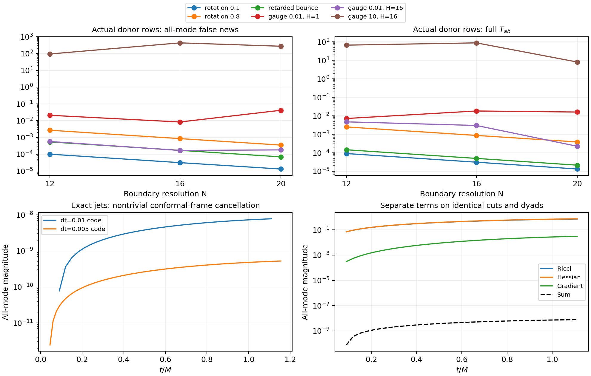
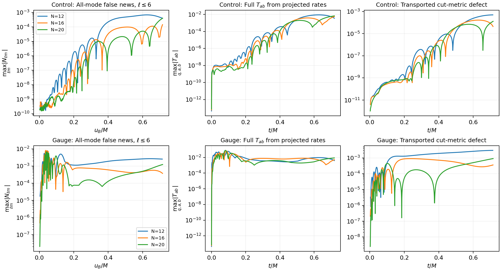
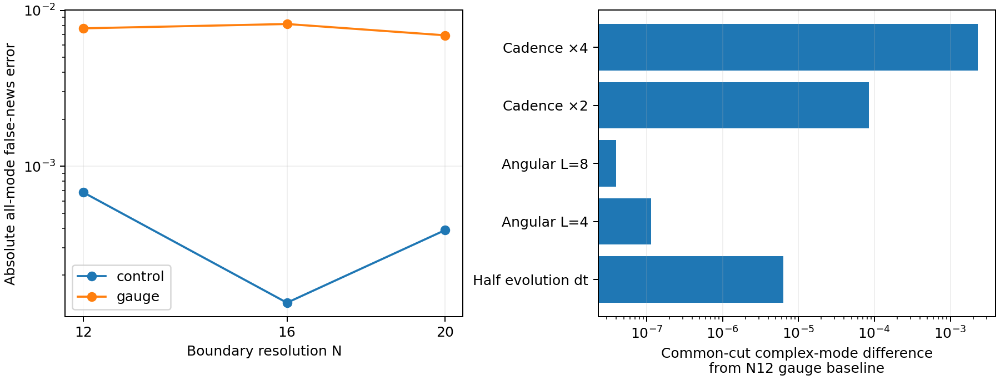
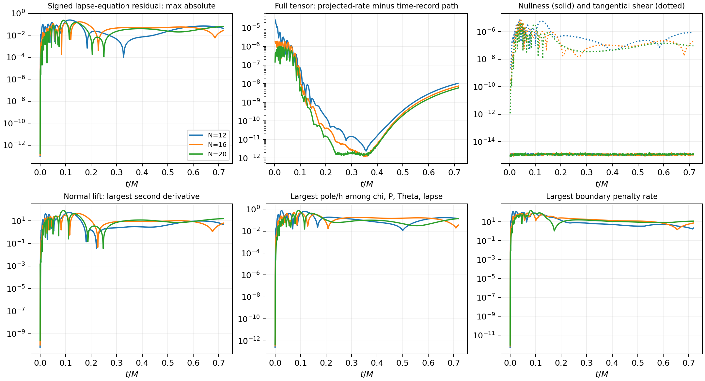
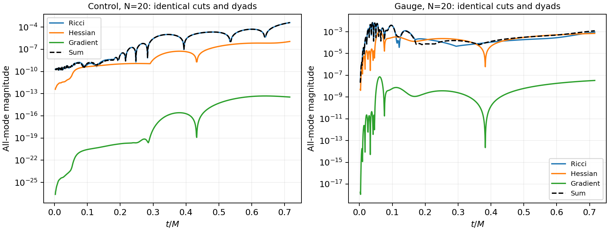

# Nonradiative validation of scheme A — 15–16 November 2026

**Verdict: unchanged scheme A is not validated by this campaign.** Exact-derivative
extraction recovers zero news in the tested nonradiative geometries, but the
literal gauge-wave donor reconstruction and the native A runs do not establish
a convergent zero-news/regularity limit at N=12,16,20. Both independent tensor
paths detect the native defect; timestep and angular-frame controls are much
smaller. This is a failed numerical validation at these resolutions, not proof
that the continuum equations admit no regular solution. The derivations,
layer distinctions, and remaining spatial-resolution limits are in
[method.md](method.md).

## Test matrix

All analytic cases have expected physical news zero. All retained spin-weighted
modes and a nodal norm are measured; no background is fitted or subtracted.

| Case and reference | Implemented parameters and path | Evidence and scope |
|---|---|---|
| Minkowski and untransformed Schwarzschild | M=0 and M=1/3; exact endpoint AD jets; actual N=12,16,20 donor rows | Exact geometry/frame controls and sampled derivative floors. These are not native Minkowski evolutions. |
| Rotating Schwarzschild, Moxon V.A Eq.49; Barkett VI.3 Eq.149 | Right-handed z rotation, old phi=phi+omega*u; omega M=.1,.2,…,.8; exact jets; donor rows at .1,.8 | Full quoted rotation range at lmax=8; omega M=.8 also followed for 8 M. |
| Bouncing Schwarzschild, Moxon Eq.50; Barkett VI.4 Eqs.150–151 | x_old=x+2M sin^4(2 pi t/40M); literal finite-radius metric and independent regular inverse pullback | Literal transformation and physical Ricci checked, including R/M=15,20,25,30. Regular inverse translation reduces to Schwarzschild at scri. No moving-worldtube CCE reproduction is claimed. |
| Smooth retarded-time bouncing counterpart | Same amplitude and sine-fourth argument, with translation evaluated at outgoing U | Exact jets for 40 M, covering two actual sine-fourth periods; actual donor rows at t=5 M. This is not the literal Kerr–Schild-time Eq.50 history. |
| Schwarzschild gauge wave, Moxon Eq.51 | v=t+R+F(t-R)/R; F=A sin(.5u) exp[-(u-25)^2/100] in paper units; A=.01,.1,1,10 | Literal finite-radius conversion, exact endpoint limits, donor rows. H=1 rejects A=10 on spacelike-slice admission; a declared H=16 chart tests the complete amplitude set. |
| Nontrivial conformal-frame cancellation | Radial chart warp epsilon=.1; dt=.01,.005; lmax=4,8 | Same-cut Ricci, Hessian and gradient contributions are individually substantial. Their sum converges to zero. |
| Native Schwarzschild control | Unchanged A, full overlap, N=12,16,20, same end time .718246 M | Actual evolution → native recorder → extractor. The interior reference coordinates relax; physical nonradiation does not imply coordinate stationarity. |
| Native gauge counterpart | Identical physical data; pure lapse bump amplitude .001, center .9555, halfwidth .009, factor 1+.5(nx²−ny²) | Three spatial resolutions; N12 half evolution timestep; dense-record stride 2/4 and lmax=4/6/8 controls. No imposed Moxon coordinate history. |

The primary sources are [Moxon et al., V.A, Eqs.49–51, Table I and Fig.10](https://arxiv.org/html/2110.08635v1)
and [Barkett et al., VI.3–VI.5, Eqs.149–153](https://arxiv.org/html/1910.09677).
The PDF ambiguities, mass/time conversion, x-axis polarization convention,
regular endpoint limits, and round-initial-cut derivations are explicit in
[method.md](method.md). Barkett's different gauge profile and added z translation
were read and distinguished, but were not included in the numerical sweep.

## Analytic extraction and reconstruction

The independent forward-AD oracle supplies spacetime jets, while finite-radius
matrix pullbacks and an independent finite-difference derivative check test the
coordinate conversion. Literal physical metrics have vacuum Ricci residuals at
floating-point precision. Native row replay samples the actual archived donor
coordinates and derivative rows, including face seams. It deliberately omits
A's compatibility normal solve for coordinate gauges that do not satisfy A.
Consequently this layer tests the derivative reconstruction, not a complete
prescribed-data replay through all A boundary operations.

Exact Minkowski/Schwarzschild and gauge-wave endpoint news are at about 8e-16;
the largest retained rotating or retarded-bounce mode is below 2e-14. The full
tracefree conformal Hessian is below 1e-14 for these unwarped exact cases.
The literal gauge-wave endpoint correction is flat to every finite derivative,
so this success alone is weak evidence; the finite-radius and donor-row checks
are indispensable.

The radial conformal-chart test provides a stronger frame check. At the same
cut t/M=.6, the separate maximum mode magnitudes are .449142 (Ricci), .459754
(Hessian), and .0122536 (gradient). The sum falls from 4.64071e-9 to 3.14602e-10
when the frame timestep is halved, an observed order 3.8827. Changing lmax=4 to
8 leaves the common modes unchanged to roundoff. The long rotation develops a
cut-metric defect of 1.22e-8 from frame integration, so not every transported
frame quantity is at roundoff even when false news is.

For actual donor rows, the omega M=.1 false-news errors at N=12,16,20 are
1.011997e-4, 3.169886e-5, 1.323501e-5 (adjacent orders 4.04,3.91). Retarded
translation gives 5.428291e-4, 1.714520e-4, 7.011600e-5 (orders 4.01,4.01).
Stationary row controls reach the few-e-12 floating-point floor; assigning a
convergence order to those values would be misleading.

Gauge-wave donor results require separate interpretation. The H=1 large-A
spatial metric is nonpositive on some donors and is rejected, with the failed
attempt preserved. H=16 changes only the analytic chart and has a positive
asymptotic spacelike margin; full donor positivity is also checked. Its endpoint
lapse .25 and radial shift −.0625 explicitly violate A's prescribed endpoint
values. H=16 successes cannot validate A's gauge. The localized logarithmic
radial profile peaks near r=.99665 at this time, whereas the outermost donors
are .995/.99625/.997; most of its decay to the flat endpoint remains beyond
the resolved support. It is difficult to differentiate on these grids; any lack of
regularity convergence is reported rather than replaced by the exact endpoint
zero.

The follow-up completed all 24 cases without an admission error; 57 analytic
case products are retained overall. Four original H1 attempts record slice
rejections. Two interrupted N20 cases were recovered; the interrupted H1 A=10
dt=.001 attempt was not rerun after the other H1 stencils failed admission. This
chart does **not** cure the derivative-support problem. At A=10, sampled
false-news maxima are 94.52, 433.32, 273.28 and full-T maxima are 66.77, 88.58,
8.156 at N=12,16,20. These gross errors fail the zero-news reconstruction test.
Changing the sampled-time step .001→.002→.004 changes the N12 false-news
maximum by less than 3e-10, localizing this failure to spatial sampling rather
than recorded-time differentiation. Exact H16 endpoint news remains 8.12e-15.
At A=.01 the H16 news errors are 5.76e-4,1.69e-4,1.82e-4; the corresponding
unperturbed H16 control is 5.70e-4,1.75e-4,7.05e-5. There is no uniform
amplitude-wide convergence claim. H1 A=.01 is also nonmonotonic
(2.10e-2,8.38e-3,4.17e-2). All amplitudes and full tensor/nodal errors are
retained in `measurements.json`.

## Native data and diagnostic integrity

The only initial-data edit is lapse field 18. Every physical-constraint input,
shift, and dynamical auxiliary is bitwise identical between control and gauge
seeds. The half-step seed is identical in every field; only its requested-dt
identity token and timestep header differ by two. Thus initial discrete H/M/Z
are equal, including the reference's existing discretization error. The seed
is separated from scri but overlaps the outermost N12 donor support; actual
reconstructed initial jets agree to 2.38e-15 and normal lifts and projected
rates agree exactly. A broader rejected seed was never gauge-evolved on Aurora.

Zero-step restarts of the saved initial checkpoints independently evaluate the
existing full constraint diagnostics. Initial H RMS at N=12,16,20 is
1.340e-9,1.197e-9,1.382e-9; M RMS is 9.65e-13,9.93e-13,9.27e-13; Theta and Z
RMS are zero. N12 control and gauge produce identical initial norms. These are
reference-derivative floating-point errors rather than a deliberately added
physical perturbation. No timestep is taken in this check, and its commands,
checkpoint hashes and histories are retained with job 9093626.

The diagnostic recomputes the actual surface vector field on accepted-state
jets, differentiates the five-component determinant-one chart, fixes alpha_t=0,
and uses beta_t=−s_t n. Both full T_ab evaluations share the native spatial jets:
one uses these projected rates, the other seven accepted records. The signed
lapse identity is evaluated pointwise before extrema, with its finite-resolution
terms retained. Nullness alone and small tangential shear are not substituted
for full four-dimensional regularity.

Two N12 CPU/MPI steps with diagnostics off/on give **24,704,784 bitwise equal
checkpoint scalars**. All 205 reused Aurora numerical objects have identical
before/after hashes; only the recorder object and test-only seed main are built.
The 14 focused CTests and existing Python frame/news regressions pass. Source,
input, executable, seed and final-checkpoint hashes are retained. No A equation,
parameter, penalty, endpoint projection, shift solve, normal lift, or overlap
policy was changed.

The outgoing lapse principal-speed estimate gives travel times .05419–.08240 M
from the seed support to scri. Native runs extend to .718246 M, more than eight
longest outgoing transits. This measures late post-outgoing-transit behavior;
it does not establish a fully settled interior or a long-time stability result.
The narrow pulse is only coarsely resolved across its radial width at these N.

## Native measurements

All principal runs use M=1/3 and reach t/M=.718246.
T values are maximum absolute Cartesian components in the common native
conformal chart, over points and accepted interior stencils. False-news
magnitudes use the stated Bondi normalization; all complex modes through l=6
are retained. The numerical comparisons interpolate them onto common Bondi
cuts, rather than equating native coordinate time with Bondi time.

| Case | Sampled max mode | Nodal max | Full T (rate path) | Max path difference | Lapse compatibility | Cut-metric defect |
|---|---:|---:|---:|---:|---:|---:|
| control-N12 | 0.00067961 | 0.00044602 | 0.0089305 | 1.0429e-08 | 0.059299 | 0.00049336 |
| control-N16 | 0.0001432 | 0.00010364 | 0.0054518 | 7.464e-09 | 0.032421 | 0.00016651 |
| control-N20 | 0.00040018 | 0.00025756 | 0.0066996 | 5.9324e-09 | 0.043538 | 0.00012887 |
| gauge-N12 | 0.0075615 | 0.0083525 | 0.061139 | 2.6812e-05 | 0.24198 | 0.00297 |
| gauge-N16 | 0.0081712 | 0.0089685 | 0.066119 | 1.9362e-06 | 0.16537 | 0.00089431 |
| gauge-N20 | 0.0069174 | 0.007622 | 0.079665 | 1.0367e-06 | 0.22764 | 0.0008989 |

Neither family approaches zero monotonically over this sequence. In particular,
the gauge full tensor grows .06114→.06612→.07966 while the tensor-path difference
shrinks. Nullness remains below 1.65e-15; the gauge tangential shear is only
6.93e-6,6.86e-6,4.48e-6. Those weaker conditions do not establish full regularity.
Gauge nodal RMS errors are .003423,.003693,.003125, consistent with the failure
seen across all modes. The signed lapse identity's algebraic residual is below
2e-15 despite its nonzero compatibility value in the table.

On common Bondi cuts, the control errors are 6.79630e-4,1.33271e-4,3.88815e-4,
with adjacent effective orders 5.66,−4.80. Gauge errors are
7.66521e-3,8.17122e-3,6.91743e-3, with orders −.22,.75. Here an effective order
is log(error_coarse/error_fine)/log(N_fine/N_coarse), not an asymptotic-order
claim. The common intervals are u_B/M=[.004225,.714538] for control and
[.004225,.714140] for gauge. For late cuts u_B/M≥.5, gauge errors remain
2.68260e-3,5.66729e-4,1.21238e-3, also nonmonotonic. The initially small control
errors grow during coordinate relaxation: for u_B/M≤.15 their maxima are
1.37e-7,9.70e-9,2.41e-9, but the later maxima are the total errors above.
Thus neither the transient nor the late segment establishes a zero-news limit.

At N12, the following maximum common-mode differences from the baseline
separate extraction and timestep effects:

| Control | Max complex news-mode difference |
|---|---:|
| Half evolution timestep, same physical recorder cadence | 6.2894e-6 |
| Frame lmax=4, comparing common l≤4 modes | 1.1435e-7 |
| Frame lmax=8, comparing common l≤6 modes | 3.9773e-8 |
| Recorder cadence ×2 | 8.4228e-5 |
| Recorder cadence ×4 | 2.2989e-3 |

Dense-record T_fd differs from the projected-rate path by 2.6812e-5. Decimation
by two and four increases that difference to 1.5549e-4 and 1.2944e-3. The fast
early pulse is therefore poorly represented by stride four; dense records are
used for the principal result. The half-step peak T changes by only 3.99e-6; the largest full point-matched
tensor difference is 5.0324e-5, still much smaller than the .0611 baseline defect.
These controls are measured differences, not tolerances chosen to declare a pass.
A common-cut interpolation can have a slightly larger peak than the original
sampled waveform; both the sampled peaks and interpolated comparison values
are retained explicitly.

Gauge pole/h maxima for (chi,P,Theta,lapse) are (.0922,.672,.749,.130),
(.0438,.472,.429,.0845), and (.0571,.723,.624,.140) at N12/16/20. The largest
penalty rates are 129.4,85.1,157.5; the largest second derivatives of normal
lifts are 55.18,45.94,84.06. These too lack uniform decrease. They are different
component diagnostics with their native normalization, not interchangeable
error norms. All signed groups, first/second lift derivatives and point-matched
witnesses are retained in the evidence.

The native Ricci, Hessian and gradient pieces are evaluated on identical cuts
and dyads and sum to the extracted result within 3.23e-15. At N20 their separate
gauge maxima are .0069233,.0010357,7.21e-8; the control values are
3.99050e-4,1.12600e-6,4.85e-14. Unlike the strong analytic frame test, they do
not cancel to zero. These are separate extrema, not summands of a pointwise
identity; the plotted sums use the actual complex contributions before reduction.

The full-volume constraint error is not hidden by the exterior norm. At the
final cut, the control's H RMS is 198.14,31.64,7.17 at N=12,16,20, while the
horizon-exterior H RMS is 1.976e-3,8.432e-4,3.961e-4. The gauge exterior values
are 1.977e-3,8.445e-4,4.064e-4. Exterior M RMS is respectively
1.431e-3,5.718e-4,2.653e-4 for the gauge runs. The exterior mask is the code's
complete harmonic apparent-horizon mask, using its existing Jacobian-volume
norm convention. Errors inside the horizon dominate the full H norm. These
finite-resolution evolutions are consequently not treated as exactly vacuum
at late time, even though their initial physical constraints are near the
reference-derivative floor. The constraint histories and all signed scri groups
are retained in `native-summaries/histories.json`.

## Failure localization and limits

The first substantial native failure is visible in the recorded boundary
geometry and its projected evolution rates, before angular frame transport.
The independently time-differenced tensor reproduces it. The signed lapse
identity holds to roundoff as an algebraic equality, while its value is nonzero;
hard projection of alpha to one therefore does not establish compatibility.
The finite-step projection tangent and accepted-record derivative checks do
not support a stale-RHS or discarded-gzz bookkeeping explanation.

At the N12 peak, t/M=.0957662 and x≈(−.995732,−.065264,−.065264), the two paths
give T11=−.06113860 and −.06113857. This point is near a face center, not a seam.
The signed lapse terms at that same point are
`.00092456 + .22835972 − .04402174 + .95892993 + .99993491 − 2 = .14412738`.
A small tangential shear and roundoff-level nullness would miss this defect.
The full pointwise witnesses also retain all penalty components; no separately
maximized summands are combined to manufacture this identity.

The extraction controls make timestep, cadence and harmonic frame truncation
unlikely to explain the dominant N12 defect. They do not distinguish an
underresolved native spatial operator from an inconsistency of A's continuum
boundary treatment. The pulse is narrow, and three modest resolutions cannot
settle that distinction. No unique A equation or lift correction has been
identified, and none is implemented here.

Analytic chart admission failures and the unresolved analytic gauge-wave radial
layer are separately localized before native evolution. They are not evidence
against A. Native false news is an extraction contamination estimate while the
necessary regularity tensor is nonzero, rather than certified physical radiation.
Its measured transient scale, roughly 1e-2 in the tested news convention, prevents
these runs from certifying substantially weaker signals during similar gauge
dynamics. This is a configuration-dependent contamination level, not a universal
noise floor or a license to subtract a background.

Coverage is intentionally finite: no SpECTRE characteristic evolution was run;
no lmax=12–24 reproduction of Table I was attempted; the donor replay uses three
spatial resolutions at selected times; only one weak angular native lapse pulse
and one half-step resolution are tested. No native rotation is imposed because
its tangential endpoint shift is incompatible with A. These tests do not prove
a continuum theorem or identify a unique mathematical correction to A.

## Reproduction and compute cost

All task allocations used **two Aurora debug nodes**, sequentially, and have
finished. PBS reports **2.66444 node-hours** in total, including failed attempts;
this is twice `resources_used.walltime`, not an independent billing statement.
The two cancelled queued jobs consumed no reported execution time.

| Job | Work | Reported walltime | Outcome |
|---|---|---:|---|
| 9093378 | First pilot launch | 0:19 | CLI output parameter rejected before evolution |
| 9093394 | Corrected 100-step control/gauge pilot | 1:40 | Completed |
| 9093424 | First pilot analysis | 1:38 | Stopped after MPI ranks both defaulted to zero |
| 9093448 | Corrected pilot analysis | 1:32 | Completed |
| 9093456 | Original analytic matrix | 1:45 | H1 slice rejections; peer interrupted; products retained |
| 9093470 | N12 control/gauge/halfdt | 9:47 | Completed |
| 9093485 | First N12 analysis | 1:43 | Halfdt identity check rejected expected requested-dt difference |
| 9093536 | N16 pair and analysis | 17:51 | Completed |
| 9093556 | Corrected N12 analysis, controls, analytic follow-up | 17:59 | Completed |
| 9093626 | N20 pair, zero-step constraint checks, analysis | 25:42 | Completed |

9093351 was cancelled after the scheduler's account-check hook rejected a
walltime alteration; 9093442 was cancelled before running after the MPI rank
issue was identified. Only this task's jobs were cancelled. The rank launcher
now requires consistent global-rank variables. The halfdt check permits only
the exact factor-two requested-dt identity change and still compares every
initial field bitwise. These were infrastructure fixes; no A treatment was
changed to rescue a test.

Measured evolution-command times are 159.71/158.37/226.94 s for the N12
control/gauge/halfdt, 255.46/233.68 s for N16, and 333.98/336.44 s for N20.
The passive executable overlay took 74.43 s to build, and the admitted seed
writer 17.05 s on the service node. These timings informed the bounded
extensions; numerical evolution and substantial analysis ran on allocated nodes.

Exact commands, job IDs and product locations are in [reproduce.md](reproduce.md)
and the compact provenance. Large native archives and full pointwise
arrays remain at `/lus/flare/projects/CompactBinaryMerger/hzhu/nonradiative-20261115`.
Local collected evidence is at `/Users/hz0693/research/results/nonradiative-20261115`.
The compact committed evidence is in
[../evidence/nonradiative-20261115](../evidence/nonradiative-20261115).
