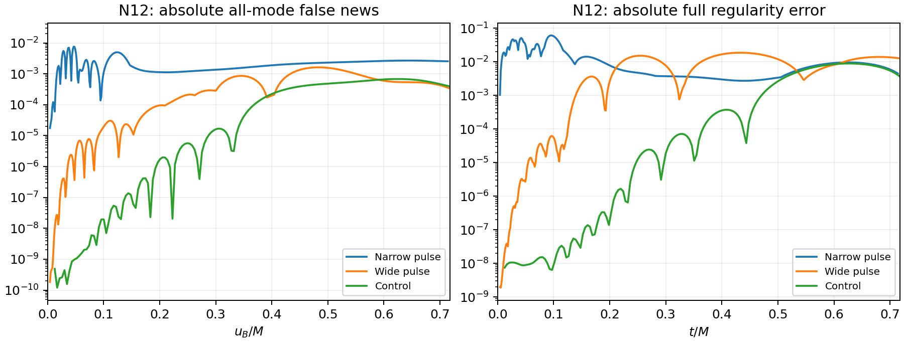
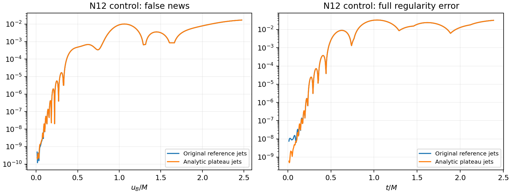
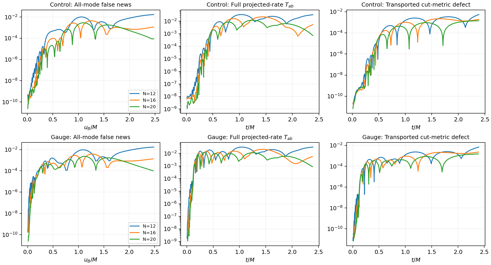
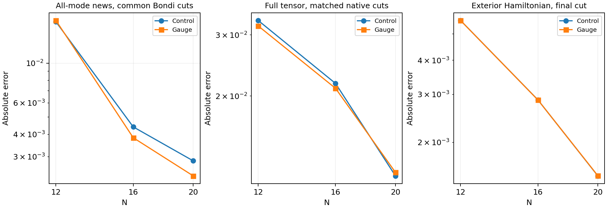
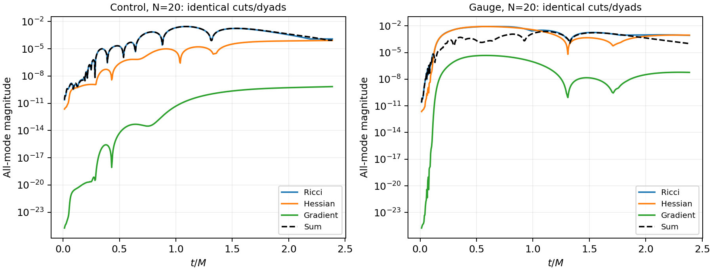
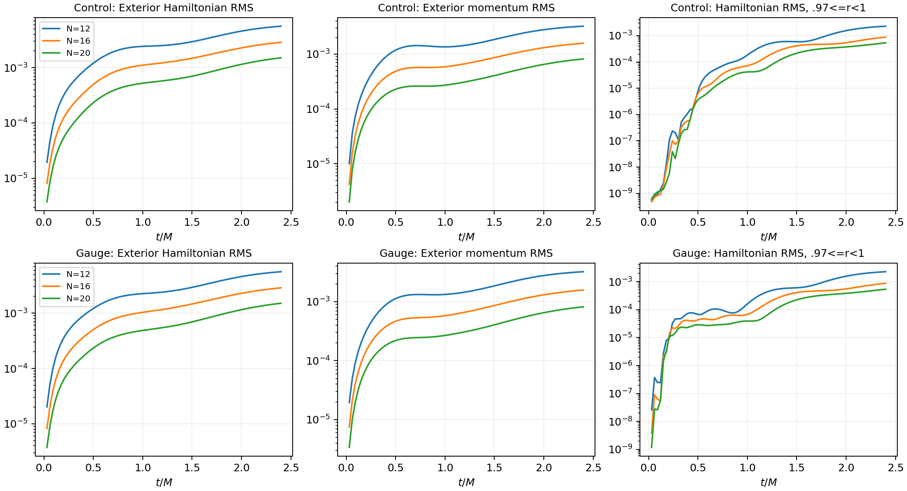
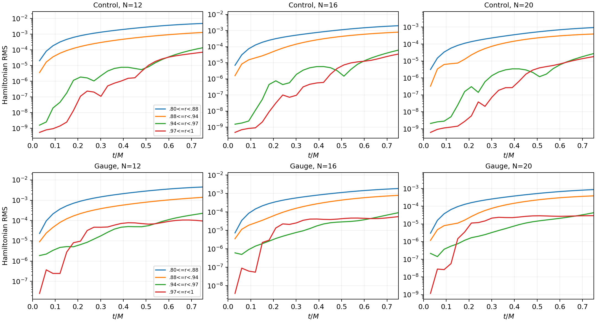

# Wider-pulse follow-up and minimal reference correction

**Completed: the wider pulse improves the benchmark, but scheme A is not yet
validated for accurate zero-news native evolution.** Full-interval false news,
regularity and exterior constraint errors decrease over N12/N16/N20. Their
orders vary by window, the unperturbed control has comparable errors, and the
N20 full tensor remains about .012. Timestep, recorder cadence and tested
frame-cutoff effects are much smaller. A minimal reference-derivative correction
improves the stationary reference floor without repairing the evolved defect.
The bulk scheme is retained.

The parent analytic-extraction results and their limitations remain in
[the original report](../nonradiative-20261115/report.md). This follow-up tests
native evolution and a small numerical implementation correction; it does not
replace the analytic Moxon test families or resolve their under-sampled literal
gauge-wave layer. Reproduction and provenance are in [reproduce.md](reproduce.md).
The independent assessment prompt is [review-prompt.md](review-prompt.md).

## Better-resolved initial gauge data

The conformal-lapse-only perturbation is

```
delta alpha = .001 exp[-6 z^2/(1-z^2)] [1+.5(nx^2-ny^2)],
z=(r-.86)/.08, |z|<1; zero outside.
```

Its support is (.78,.94), 8.89 times the old support width; its FWHM is about
4.5 times larger. The actual radial shells contain 27/36/45 primary centers in
the support and 8/11/13 above half the radial peak at N12/16/20. Simply making
the old bump wider retained poorly differentiated steep tails. The chosen
shape keeps compact C-infinity support while reducing those tail errors.

| N | Wide first-derivative relative max error | Wide second-derivative relative max error |
|---|---:|---:|
| 12 | .003800 | .004278 |
| 16 | .001481 | .001750 |
| 20 | .000619 | .000813 |

These are centered fourth-order **radial-stencil survey** errors normalized
by the dense analytic derivative maximum, with exact ghost values. They do
not measure the full native halo/interpolation operator, angular derivatives,
compatible lapse Hessian or evolving solution. The old N12 first/second errors
were .327/.181 by the same survey. Center and shape have changed as well as
width, so early-time improvements are not a width-only causal experiment.

On the actual shared N12 Bondi interval .004225–.714140 M, the old narrow
pulse's all-mode false-news maximum falls from .007661 to .001620 with the
new pulse. On the separately shared native interval .004225–.714021 M, the
full-T maximum falls from .061139 to .018718. This is a material improvement
in the test data, with a remaining nonzero evolved error.



Every persisted initial field except lapse is bitwise identical to the control.
Per-run seed checks cover 24,704,784 / 45,077,136 / 74,312,784 scalars at
N12/16/20, including physical constraint data and gauge auxiliaries. Initial
discrete constraints therefore match. The separate local N12 admission check
has H/M RMS 1.291e-9/9.747e-13, with zero Theta and Z; its actual endpoint
donor residual jets, normal lifts, projected rates and signed lapse terms
match exactly. Its initial clock residual is 9.13e-14. Endpoint donors lie
above .955, outside the pulse.

The support overlaps the configured gauge blend (.76619,.87410). Keeping B=0
and D unchanged specifies free dynamical gauge initial data; it does not make
the driver stationary or decoupled. No physical geometry, extrinsic curvature,
trace or new continuum source is added to construct an outgoing mode.

Frozen-background outgoing lapse travel is 1.868 M from the inner support edge,
.426 M from its center and .093 M from the outer edge. Runs extend to 2.399788 M
at all resolutions, beyond that outgoing estimate. Inward components and the
background need not have settled. An earlier .718246 M window is retained for
comparison, alongside the full interval and late windows. The fixed Bondi-time
windows are descriptive comparison cuts, not characteristic-arrival bounds in
native time. The narrow/wide N12 numerical comparison separately intersects
their actual Bondi and interior native-time supports.

## Isolated reference-derivative correction

The only production edit is in `SphericalReference3D::RadialJets`. The original
routine finite-differenced quadrature/inversion-derived reference values twice
with a small fixed step, amplifying roundoff before the scri pole factors.
In the exact Schwarzschild CMC plateau with canonical Omega, it now uses the
already-existing ODE-derived first/second derivatives of chi and lapse, and
beta-radial derivative -1. Every reference value remains unchanged. Transition
jets continue to use the old routine. Bulk equations, evolution stencils,
gauge parameters, projections, penalties, normal lifts and overlap policy are
unchanged.

Writing y=1/R, F=sqrt(1+y^2-2My^3), the plateau relations are
`y'=-F/r`, `chi=(r*y/Omega)^2`, `alpha=Omega*F/y`, and `beta^r=-r`.
The existing analytic routine differentiates these identities, rather than
finite-differencing the inversion output. The remaining radial reference
components are constant in this region. At scri it uses the existing exact
limits. This is a numerical derivative correction, not a new boundary equation.

The independent stationary-vacuum regression evaluates the full point RHS and
constraints at radii .971–.997 and three angles:

| Maximum | Original jets | Analytic plateau jets |
|---|---:|---:|
| Geometry RHS | 1.06910e-6 | 1.57151e-11 |
| Gauge RHS | 5.28343e-11 | 1.48829e-13 |
| Hamiltonian/momentum constraints | 1.19415e-10 | 7.54952e-14 |

The regression fails with the original header and passes after the correction;
all 15 focused CTests pass. Two CPU/MPI steps remain finite. Fresh initial
checkpoint values are bitwise identical; the maximum two-step difference is
about 1.02e-9. This establishes a better reference derivative floor, not full
evolution accuracy. Very near r=1, inversion and floating-point cancellation
still limit the existing analytic routine; the regression does not claim
arbitrary radial-refinement accuracy. A radius numerically just below the
transition still takes the original branch.

A final guard also requires `r>profile.flat_radius`, so a non-flat-Omega
configuration whose inner gauge extends past the geometric transition keeps
the original jets. A dedicated regression fails without this guard. For every
validated flat-Omega profile, the existing canonical-Omega condition already
implies `r>=outer_radius>flat_radius`; the guard therefore changes no campaign
point. The immutable Aurora candidate predates this additional guard, which is
recorded explicitly rather than relabeling its source hash. The guard-only
CPU/MPI comparison gives bitwise-identical initial and two-step checkpoint
payloads (24,704,784 scalars each), and all 15 tests pass after a full rebuild.

The corrected N12 evolved control starts fresh with the same input and
bitwise-identical initial values as the original N12 control, and runs to the
same 1704-cycle endpoint. It uses a separately hashed executable. Principal
wide-pulse cases continue to use the original executable, so their change is
not confounded with the correction.

That paired evolution is complete. The full-T peak changes from
.0330358769 to .0330358892, and the maximum common-cut news-mode difference
is 5.79e-9. The much larger evolved defect therefore survives this correction.
A difference between peak norms is not a point-matched tensor difference.
The separate comparison at identical points and native times gives maximum
T_rhs change 1.251e-8 (T_fd 1.251e-8), against an evolved defect near .033.
Penalty rates differ by up to 2.67e-5. The correction is therefore not a cure
for the evolved defect. This does not establish that every uncorrected
transition-region derivative floor is harmless.



## Interpreting boundary attribution

A direct contracted Koszul formula independently reconstructs the full tensor
from first metric derivatives. At fixed metric values it splits the chi-penalty
time-rate contribution, shift-normal-lift spatial-derivative contribution, and
remainder. It checks exact additivity and agreement with stored native-rate T.
The beta time-rate split includes the exact tangent of beta=-sqrt(chi Q)n.

At the old N12 narrow-pulse tensor maximum, one signed component is
-0.0611386 = -0.0185890 + 0.0197018 - 0.0622514. Tensor agreement and additivity
are at 5.1e-16/2.1e-16. This does not justify deleting either term. The actual
time rates already depend on compatibility and lifting, and a changed closure
would evolve a different state. The decomposition is not an evolved ablation.

## Spatial measurements

All principal cases use M=1/3 and the inherited Cartesian-x polarization
convention, with N=d[r(h_plus-i h_cross)]/du_B. All 45 complex modes through
ell=6 and nodal norms are retained. Tensor maxima are absolute Cartesian
components in the common native conformal chart, not invariant scalar norms.
Three one-sided edge stencils at each end are excluded from reported tensor
maxima/path comparisons. Spatial-convergence tensor norms also use matching
nominal native cuts at the common physical cadence, taking every third dense
N12 gauge record and checking timestamp agreement to 1e-12 native units.
Common-cut news comparisons use Bondi time; constraint
and tensor histories use native time. Neither a control waveform nor a fitted
background is subtracted to obtain a passing residual. These extractor outputs
are zero-target diagnostics; appreciable nonregularity prevents interpreting
them as physical radiation.

The principal six evolutions all reach 2.399787695 M. The following news norms
use common Bondi cuts (approximately .012675–2.47147 M for control and
.012675–2.47226 M for gauge). Full-T norms use matching native cuts over
.012675–2.38711 M at common cadence. Raw sampled maxima remain in the case
summaries; in particular, the denser N12 gauge maximum is .0319521 rather than
the matched-cadence .0318624 below.

| Case | N12 | N16 | N20 | Effective orders 12→16 / 16→20 |
|---|---:|---:|---:|---:|
| Control all-mode false news | .0170375 | .00440044 | .00284191 | 4.71 / 1.96 |
| Wide-gauge all-mode false news | .0173327 | .00382744 | .00234195 | 5.25 / 2.20 |
| Control full T | .0330359 | .0217514 | .0117735 | 1.45 / 2.75 |
| Wide-gauge full T | .0318624 | .0210577 | .0120503 | 1.44 / 2.50 |

These are effective orders of zero-target maximum norms, not a Richardson
estimate from converged solutions. Peak times change with resolution. The
short Bondi window is especially cautionary: control errors are
6.80e-4, 1.62e-4, **4.09e-4**, while gauge errors are
1.620e-3, 7.657e-4, 6.364e-4. In the late Bondi window (u_B/M≥1.9), control
errors are .01704, .001150, .000761 and gauge errors are .01733, .001360,
.000775. Thus full-interval improvement does not establish monotone convergence
on every cut or window, or that the late background has settled.

Nodal false-news maxima also decrease: .01105/.002747/.001775 for control
and .01102/.002593/.001681 for gauge. At N20 the sampled largest mode is
(ell,m)=(2,2) in both cases, at u_B/M≈1.098 and 1.120, respectively, in the
inherited polarization convention. All retained modes are preserved; this is
not a single-mode test. The false signal of order 2–3e-3 at N20 is an observed
contamination scale for this experiment, not an accuracy guarantee for weak
waves or a universal extraction noise floor.





The native-rate and accepted-record tensor paths differ by at most 5.02e-8
across the principal cases, far below the O(.01) full tensor. Their shared
spatial derivatives remain unverified by that agreement. The signed lapse
fixed-point algebraic reconstruction agrees to roundoff, while the clock
compatibility residual remains .0785/.0831 for N20 control/gauge. Nullness is
about 1.6e-15 and tangential shear about 7e-7, yet full regularity is about
.012: neither nullness nor small tangential shear establishes the required
four-dimensional condition. Transported cut defects at N20 are
.001420/.001529. These are distinct from the small numerical clock-transport
residual of order 1e-10.

On identical native cuts and dyads, the Ricci and frame contributions are
retained separately and sum to the stored news coefficients. The wide pulse
has substantial early Ricci/Hessian cancellation; the control is more strongly
Ricci-dominated. Neither contribution has been removed to reduce the result.



## Constraint growth and localization

| Final native diagnostic | N12 | N16 | N20 |
|---|---:|---:|---:|
| Control exterior H RMS | .0056041 | .0028642 | .00150545 |
| Control exterior M RMS | .0032274 | .0015803 | .00081723 |
| Wide-gauge exterior H RMS | .0056020 | .0028625 | .00150766 |
| Wide-gauge exterior M RMS | .0032263 | .0015794 | .00081818 |
| Control H RMS, .97≤r<1 | .0022799 | .00087656 | .00053070 |
| Wide-gauge H RMS, .97≤r<1 | .0022810 | .00087987 | .00053768 |

Full-domain control H RMS is 297.4/50.39/11.93, strongly affected by the
interior. That single global norm cannot localize scri error. The exterior
and radial-band norms show improving but appreciable violations even without
the pulse. Physical initial-data preservation does not prevent numerical
constraint errors during a gauge-dynamical evolution.



At the first stored post-step control sample (t/M≈.03), H RMS in
.80≤r<.88 is 2.04e-5/6.98e-6/3.16e-6, while .97≤r<1 remains
5.45e-10/4.74e-10/6.14e-10. The larger early measured error therefore occurs
in the inner surveyed bands, which include gauge/slice transitions, before
large outer-band growth. The histories do not cover r<.8 here, resolve the
exact first failing step, or prove causality. The background gauge is already
dynamical in these bands; treating it as a globally stationary solution would
be incorrect.



At matched cadence, control normal-lift gradient maxima fall
.0616→.0216→.0113, but their Hessians remain 60.1→28.2→18.5. Gauge values are
similar. Penalty-rate maxima also decrease, from about 60 to 17–18. These
large derivatives motivate a local consistency audit, but the signed tensor
split has substantial cancellation. At the N20 gauge tensor peak,
T_11=.0120503=-.00597360-.00608839+.0241123, with additivity and stored-tensor
agreement at roundoff. This is an instantaneous witness at t/M=.32955, not
permission to delete a lift or penalty or compare different peak locations
as if they were the same point.

## Temporal and frame controls

The half-step seed has identical fields and exactly half the requested and
stored timestep. It reaches 3408 cycles at the same physical endpoint. Its
stride-six recorder matches the original stride-three physical cadence.

| N12 comparison | Maximum difference |
|---|---:|
| Half timestep: all 45 common news modes | 7.09e-9 |
| Half timestep: point-matched native-rate T | 5.06e-8 |
| Dense versus stride-three news | 3.32e-8 |
| Frame lmax 4 versus 6, common ell≤4 | 3.27e-7 |
| Frame lmax 6 versus 8, common ell≤4 | 5.94e-8 |
| Frame lmax 6 versus 8, all common ell≤6 | 1.33e-7 |

The half-step news interval is u_B/M=.012675–2.473917; matching native times
agree within 4.69e-14 code units. Its T_fd difference is 4.79e-8, but that
comparison also changes the accepted-record differentiation stencil width
relative to the dense baseline and is not a pure timestep bound. The native-rate
T comparison avoids that ambiguity. The frame test changes harmonic fitting,
transport/interpolation and quadrature cutoff together; it does not bound the
native evolution's angular derivative or overlap error. These representative
N12 controls are far smaller than the observed spatial residuals; they do not
establish temporal or angular accuracy for every future configuration.

## Completion, provenance and compute cost

All eight final checkpoints (six principal cases, corrected-reference control
and half-step control) match their evolution-receipt hashes and requested
cycles/times. A bounded-memory audit checks 337,598,976 finite stored scalars,
including all 31 fields and eight persistent chi-record scalars. Finite values
and successful completion are separate from the accuracy verdict. Collected
packages have per-file hashes, and the final evidence includes source, input,
executable, build, runtime, scheduler and artifact manifests.

The half-step evolution succeeded, but its first analysis attempt failed on a
Python module-name collision. An analysis-only recovery then succeeded after
separating the unchanged common-cut routine from plotting imports. Original
failure status/logs remain; recovery verifies the final checkpoint is unchanged.
A preliminary recovery submission was cancelled before it started after
service-node preflight detected the plotting dependency. Reproduction details
and the explicit recovery chain are in [reproduce.md](reproduce.md).

| Debug job | Work | Allocated wall time | Node-hours |
|---|---|---:|---:|
| 9093867 | N12 control and wide gauge, analyses | 31m26s | 1.04778 |
| 9093938 | N16 pair, corrected-reference N12 control, analyses | 43m21s | 1.44500 |
| 9094022 | N20 pair and analyses | 41m31s | 1.38389 |
| 9094227 | N12 half-step evolution; failed initial analysis | 12m37s | .42056 |
| 9094386 | Analysis-only recovery and frame controls | 5m36s | .18667 |
| 9094380 | Cancelled before allocation | — | 0 |

Total new allocation cost is **4.48389 node-hours**, always at most two nodes
at a time. The parent campaign's 2.66444 node-hours are separate. Service/local
builds and checks are recorded separately, including the 111-second reference
candidate build and all 15 passing focused CTests. No other jobs were modified.

## Recommended next steps

The evidence supports a spatial consistency/localization investigation before
any additional production change. The following are proposed follow-ups,
not runs already performed here; their allocation estimates exclude queue wait
and should be checked against the first measured diagnostic run.

1. **Audit the actual native derivative path on frozen analytic initial data.**
   Compare `BuildPointState` and `EndpointState` jets, including the compatible
   lapse Hessian, with independent analytic jets for the wide pulse. Keep the
   actual halo exchange, full-overlap policy and reference data. Reduce errors
   by radial band and `RHSSubset` (interior, local/remote halo, surface), and save
   signed witnesses with seam/donor locations. This tests what the exact-ghost
   radial survey cannot. A two-node 10-minute diagnostic allocation should be
   the initial cap. Stop expansion once a reproducible local operator defect
   is isolated; if no defect appears, retain that negative result.

2. **Localize the earliest constraint growth in the unperturbed control.**
   Add bounded passive first-stage/first-step witnesses through t/M≈.15,
   distinguishing reference geometry from the legitimately relaxing gauge.
   Compare derivative, transport and forcing terms at the same points, with
   initial checkpoint equality and a diagnostics-passivity check. Begin with
   N12/N16 and a two-node 10–15 minute allocation. Error appearing first in
   halo-dependent points would support an interpolation audit; interior growth
   would direct attention to bulk discrete consistency; surface-only growth
   would strengthen the case for a closure audit. None of these outcomes is
   inferred from the current band averages alone.

3. **Only then expand spatial resolution or change a diagnosed implementation.**
   A short N24 control through .75 M can probe the nonmonotonic early control
   window at roughly 15–20 minutes on two nodes, based on the measured N20
   evolution cost and a conservative scaling estimate. It would not establish
   post-disturbance convergence. For an isolated implementation error, use a
   failing local regression and a paired original/corrected evolution before
   a new three-resolution sweep. A full N24 pair may exceed one debug wall-time
   limit and should not be bundled without a new measured estimate.

Keep penalties, normal lifts, lapse projection, shift compatibility and the
bulk equations unchanged while obtaining this evidence. The instantaneous
cancellations do not justify removing a term. Longer settling-time coverage,
full native angular/operator resolution, and the parent literal analytic
Moxon gauge-wave donor-layer problem remain open. The wider native lapse pulse
addresses none of those by itself, and the present results neither validate
weak-wave extraction nor prove continuum inconsistency of A.
