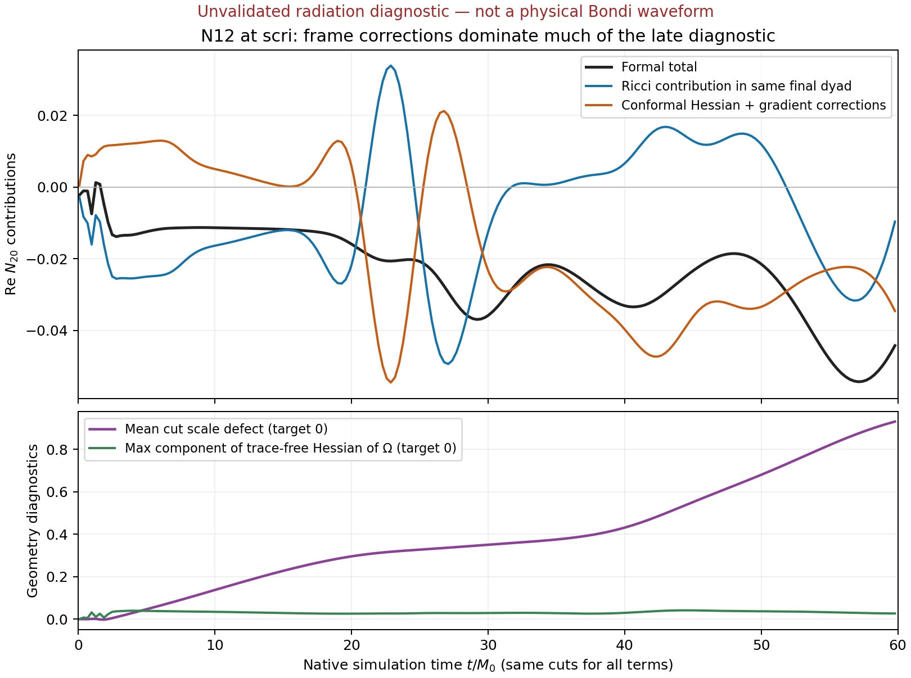

# Scri boundary and frame audit, 2026-11-15

The late N12 formal news contains large conformal-frame correction terms. This
does **not** establish a removable BMS artifact or a physical waveform. The
reconstructed spacetime fails a vacuum regularity check, and the attempted
inertial cuts acquire an order-one metric defect. A normal BMS transformation
cannot repair that condition. The immediate priority is a consistent boundary
regularity closure and extraction admission tests, followed by resolution tests.

Inspected evolution/extraction source: `f17e6cde6`, with active scri treatment A
and the validated full-overlap policy. This audit changes no evolution equations.
The separate overlap interpolation policy does not supply the missing scri
constraint/gauge compatibility. Evidence is in
[`evidence/N12-full-scri-20261115/frame-audit`](evidence/N12-full-scri-20261115/frame-audit).

## Comparison with the CMC work

Rinne's axisymmetric implementation solves the Hamiltonian constraint and
elliptic CMC/quasi-isotropic gauge equations at each RK substep. Momentum
constraints are monitored during evolution. Its outgoing endpoint equations
are regularized using Penrose or constraint Taylor limits; imposing extrinsic
curvature regularity as Dirichlet data was unstable. Its finite news formula
(Eq. 49) is gauge-specific. See [Rinne, §§2.4, 3.3–3.4, 4.2](https://arxiv.org/html/0910.0139v2).

Our implementation already has tensor pole differentiation and L'Hôpital
limits; describing it as lacking regularization would be incorrect.

| Item | Current AthenaK implementation |
|---|---|
| Slicing/gauge | Hyperbolic gauge, prescribed compactification; no global CMC elliptic solve. |
| Endpoint values | `SurfaceExchange::Project` fixes conformal lapse to 1 and shift to `-sqrt(chi Q) x`; this enforces nullness, not all vacuum regularity. |
| Normal derivatives | Active A solves three local shift-derivative compatibility conditions; polynomial lifts alter derivatives while vanishing at sampled values. |
| Singular evolution | `TensorPoleNormalJet` and `TensorScriLimit` substitute normal derivatives of complete pole numerators. |
| Regularity control | `SphericalPolicy::Boundary` adds terms proportional to `penalty/spacing` involving pole and regularity residuals. |
| Remaining gauge residual | Endpoint lapse rate is zero, while `rate.clock` records the regularized lapse equation's requested rate. Only shift compatibility has a failure threshold. |
| News | Offline four-metric Ricci calculation, conformal-frame transport, and projection onto constant transported-time cuts. |

The key distinction is **preservation of the regularity relations**, not merely
elliptic versus hyperbolic evolution. Moncrief–Rinne derive boundary limits from
constraints to the required Taylor orders and show preservation of their
regularity conditions. Their discussion allows extension to other formulations;
it does not prove our Z4c closure consistent. See
[Moncrief–Rinne, §§III–IV, VI](https://arxiv.org/html/0811.4109v2).

For a schematic pole `F/Omega`, replacing it by `d_n F/d_n Omega` is a continuum
limit only when `F|scri=0`. Our code can return a finite endpoint rate even when
that numerator is nonzero. Penalty control must therefore be checked for
consistency and convergence, including its `1/h` scaling; stable finite rates
alone are insufficient. Hard projection of every outgoing field is not the
recommended remedy.

## Quantitative frame decomposition

Let `lambda=log(omega)` and let `d^a` be the **same final normalized complex dyad**
used by the existing extractor. The formal diagnostic decomposes exactly as

```
N_formal = -R_ab d^a d^b
           + 2 (nabla_a nabla_b lambda) d^a d^b
           - 2 (d^a partial_a lambda)^2.
```

The omitted Ricci transformation terms are metric traces and vanish against
this null dyad. The audit reconstructs 205 native cuts from the original metric
cache, uses the saved L8 frame, and verifies both the nodal sum and its projected
mode sum against the existing extraction. All three terms use identical cuts,
dyads, angular weights, and mode conventions. The first term already includes
the frame's dyad normalization; it is not news in an independent native frame.

| Native t/M0 | Ricci contribution, Re N20 | Conformal corrections | Sum |
|---:|---:|---:|---:|
| 5.011 | -0.024995 | +0.012549 | -0.012446 |
| 20.011 | -0.021688 | +0.005784 | -0.015904 |
| 30.000 | -0.012634 | -0.023200 | -0.035833 |
| 39.991 | +0.006522 | -0.039599 | -0.033077 |
| 50.011 | +0.011863 | -0.033372 | -0.021509 |
| 59.010 | -0.019916 | -0.029196 | -0.049112 |

Corrections have larger angular RMS than the Ricci term on all 103 sampled cuts
at `t>=30 M0`. The Hessian term dominates the correction. This supports the
claim that late formal news is strongly affected by frame construction, but
does not assign a physical/error fraction: these pieces are not separately
gauge invariant, and necessary gauge corrections can be large even in an exact
solution. Deleting them is not a valid extraction method.

The plot and table use native-time cuts to preserve the additive comparison.
They are not the final modes resampled onto a common Bondi-time grid.



At `t≈59 M0`, `omega=1.595–1.623`, angular variation of `log(omega)` about its
mean is at most 0.01141, direction-label displacement is 0.00309, and angular
clock spread is 0.5931 M0. The round-cut mean scale defect is +0.9157. Thus the
large cut defect is mainly an overall scale drift, not a large angular relabeling.
Small angular variation can still produce substantial second-derivative terms.

## Why this is not ordinary BMS freedom

Between Bondi frames, ordinary smooth BMS transformations act homogeneously on
news: `N' = exp(-2 i phase) K^-2 N`, evaluated at transformed time and angles.
Supertranslations shift shear/strain by a time-independent term; they do not
create news from zero. They can change individual modes by retiming, rotation,
boosting and mode mixing. See [Boyle, Eqs. 19–23](https://arxiv.org/html/1509.00862v3).

Our evolving `omega`, generator labels and clock attempt to construct a first
Bondi frame from computational coordinates. They are not a residual BMS map
between two already admitted Bondi frames. The extraction already includes
conformal Hessian terms and tilted-cut time components; simply adding a generic
"BMS correction" would miss the present failure.

For a smooth vacuum conformal completion, the necessary endpoint condition is

```
T_ab = nabla_a nabla_b Omega - g_ab Box(Omega)/4 = 0.
```

This follows directly from the trace-free conformally transformed vacuum
Einstein equation, `Omega R_ab^TF + 2 (nabla_a nabla_b Omega)^TF = 0`.
At scri, under `g'=omega^2 g`, `Omega'=omega Omega`, direct differentiation gives
`T'_ab=omega T_ab`. Its vanishing is therefore conformally invariant, although
a coordinate-component maximum is not an invariant error norm. No regular
nonzero conformal rescaling turns a nonzero tensor into zero.

For these recorded N12 jets, the full run's maximum component defect is
0.0413262, despite nullness at roundoff and native angular shear only about
3.3e-5. The maximum round-cut RMS defect is 1.31866. The offline clock transport
residual is only 6.6e-6: accurately solving that transport ODE does not establish
that the evolved geometry admits the assumed Bondi frame. This transport
residual is also distinct from the evolution's unsolved lapse/clock residual.

The frame transport sets `n(lambda)=-Box(Omega)/4`. Its mismatch with the
screen-area expansion is measured by `screen_trace(H)/n^t - Box(Omega)/(2n^t)`,
already recorded as `round_scale_rate_mean`. Replacing this source by an area
normalization might suppress the plotted scale drift, but would not remove
the full tensor defect. Such an alternative is a sensitivity test, not a repair.

An additional check changes the off-surface extension by `lambda -> lambda+k Omega`.
It leaves the boundary frame values fixed but changes the formal projection by
`2 k H_ab d^a d^b`. For `k=1`, the maximum sampled nodal change is 3.26e-5,
far smaller than the observed late corrections. Thus this particular extension
freedom does not explain their size. It is not a bound for arbitrary extensions.

## Concrete implementation work, in order

1. **Expose and admit the boundary geometry.** Extend the native diagnostics
   with all independent components of `T_ab`, pole numerators and their normal
   limits, gauge residuals, and separate regular, L'Hôpital and penalty RHS
   contributions. Reconstruct `T_ab` both with the actual projected endpoint
   RHS and with accepted-time differences. This separates a continuum closure
   defect from derivative, projection, seam or time-sampling error. Track
   h-scaled penalty contributions, not just residual maxima. Relevant files:
   `tensor_scri.hpp`, `spherical_policy.hpp`, `surface_exchange.cpp`,
   `boundary_history.cpp`, and the recorder/extractor.

2. **Derive a compatible Z4c endpoint closure.** Expand the actual constraints
   and gauge equations through the orders required by every singular term;
   establish which regularity conditions the endpoint RHS preserves. Account
   for lapse clamping, nullness projection, normal lifts and penalties together.
   A nonzero lapse-equation residual alone does not prove a physical defect:
   a boundary gauge may replace that equation, but the replacement must fit the
   regular vacuum boundary system. Do not assume that a fourth local normal
   unknown solves everything. Existing B/C code already changes lapse/shift
   derivatives; `ReconstructRegularScri` exposes a remaining invariant and
   explicitly preserves even an erroneous `sqrt(chi Q)`. C adds a gauge source.
   Neither is an established fix for this binary. A CMC elliptic formulation is
   a larger alternative, not a demonstrated prerequisite for success.

3. **Make extraction validity explicit.** `FrameTransport.observe` currently
   orthonormalizes the actual cut metric even when its defect is order one.
   This produces a normalized dyad, not a unit-sphere Bondi cut. Add a structured
   validity result with an accuracy-budget-based regularity/roundness criterion,
   preserving diagnostic output while preventing physical flux/strain claims
   from failed data. Store the above decomposition in routine output. Initial
   cut uniformization is missing, but the fresh initial cut here passed the
   roundness check, so that omission does not explain its later drift.

4. **Complete frame and gauge tests.** For nonround starts implement sphere
   uniformization; verify the polarization transport residual of our
   coordinate-derived dyad, adding explicit phase transport if required. The
   characteristic literature supplies an initial curvature equation,
   conformal-factor transport and a parallel-propagated polarization condition
   ([Babiuc et al., Eqs. 31–36](https://arxiv.org/html/0808.0861v2)). Existing
   manufactured tests cover conformal/time gauges and rotation, but add long
   stationary zero-news cases and analytic boosts/supertranslations, including
   angular cut changes. Coordinate-derived polarization can already be correct
   in a truly inertial round frame; a missing phase ODE is not by itself a bug.

5. **Validate evolution before a long binary rerun.** Require stationary
   Schwarzschild zero news and a weak radiative perturbation with known signal
   through the actual native evolution/recorder. Compare matched N12/N16 and
   preferably a third grid, carrying the full tensor and waveform diagnostics.
   Prior N16/N12 residual ratios were 0.196 (`chi Q-1`), 0.673 (connection),
   0.702 (native shear) and 0.853 (clock), in the matched 27.5–29 M0 interval.
   These two-grid decreases do not determine a zero continuum limit. Old N16
   lacks the recorded four-metric/frame data needed for a waveform comparison.

6. **Add independent radiation and physical BMS alignment.** Derive a regular
   asymptotic shear or rescaled-Weyl extraction in our variables and compare it
   with news, including conventions and mass loss. Direct scri Psi4 means the
   finite radiative coefficient, not unrescaled physical Psi4 (which decays at
   infinity), nor a nonzero conformal Weyl numerator divided by zero. The
   characteristic construction provides such a regular limit and needs higher
   derivatives ([Babiuc et al., §III.2](https://arxiv.org/html/0808.0861v2)).
   Differentiating this same unvalidated news would not be independent. Once a
   Bondi frame is admitted, add shear and the appropriate Bondi mass/momentum/
   angular-momentum aspects for rest-frame, center-of-mass and supertranslation
   choices; these are not supplied by the current news-only output.

The audit identifies necessary work and a concrete leading closure concern. It
does not yet identify which evolution term is responsible for the full tensor
defect, prove nonconvergence, or establish that all late signal is spurious.

## Reproduction

The evidence script takes the existing read-only cache and final L8 output:

```sh
OPENBLAS_NUM_THREADS=1 python scri_frame_audit.py \
  --source SOURCE_ROOT --cache METRIC_CACHE \
  --result analysis-through-42603-L8 --output NEW_AUDIT_DIRECTORY
```

It asserts reconstruction of the original native-cut coefficients, and records
the baseline NPZ hash and its own hash. `audit.json` preserves all 205 sampled
rows; `decomposition.csv` and the plot are derived from that file. The larger
complex mode decomposition NPZ remains in the local/remote result directories.
No evolution run or science parameters were changed for this audit.
