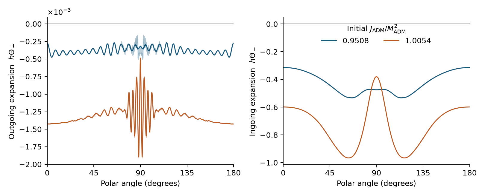

# Equatorial photon-ring validation

The opt-in boundary is `mesh/ix2_bc=reflect` with `mesh/x2min=0` and the existing Cartoon axis at `x1min=0`. The refined family uses 24 bins in the prograde azimuthal direction cosine, 48 meridional sectors, fourth-order transport and source projection, and SSPRK(10,4). The baseline full-domain solver revision is `e430bbe7`. The full-domain reference deck is `inputs/boltzmann/refined_ring.athinput`. Use the identical elliptic initial-data file for each half/full pair.

## Eight-B200 comparison

All four 0.9508 runs used the same final executable, the same eight physical GPUs on `sai-n02g2`, outer faces at distance 36, and 569 timesteps through 0.2 M. Time-mean blocks are weighted by physical timestep. Wall time includes startup, output and the final checkpoint. The memory column gives the largest one-second device sample.

| Layout | Mean active blocks | Wall seconds | GPU-hours | Saving | Peak MiB/GPU |
|---|---:|---:|---:|---:|---:|
| Full, original exterior | 114.95 | 169.77 | 0.37727 | — | 15,932 |
| Half, original exterior | 57.47 | 115.81 | 0.25736 | 31.78% | 15,928 |
| Full, coarse exterior | 80.53 | 139.58 | 0.31018 | 17.78% | 15,932 |
| Half, coarse exterior | 40.26 | 100.53 | 0.22340 | 40.78% | 15,928 |

The half domain with a coarse exterior used the fewest GPU-hours. Across the six saved comparisons with the full original-spacing mesh its largest centroid difference was 8.89e-16 M. The largest metric difference on the common spatial lattice was 2.63e-4 in the axial metric component, versus 6.22e-3 from sampling the reference output at twice its native spacing on the same slice. These measurements cover initial infall. The original-boundary full/half pairs and the winning square layout are undergoing separate long-interval qualification at both spins. The production bisection retains its existing setup.

On the original (36,18) boundary the independent 0.9508 full and half evolutions have passed the first minimum in the radiation centroid. Across eight sampled snapshots through 2.05614 M, their circumferential centroids differed by at most 1.36e-9 M and integrated vertical stresses by at most 1.56e-10. The reference centroid was 1.49989 M at 1.88710 M and 1.50306 M at 2.05614 M. At the latter time the largest matched-time metric difference was 4.77e-7, compared with 4.63e-2 upon two-cell sampling of the reference field. The independent evolutions have yet to reach the archived trapping window.

## Reflection and diagnostics

In the evolved component order \( (\rho,z,\phi) \), the reflection matrix is `diag(1,-1,1)`. A Cartesian tensor component acquires one minus sign per axial index. The odd Z4c fields are gXY, gYZ, AXY, AYZ, GammaY, betaY and BY. Lapse, chi, trace variables and the other components are even. The odd radiation moments are Sxy, Syz and Sy. Syy, the vertical normal stress, is even.

The azimuthal tetrad leg is aligned with the axial Killing vector. Its tangential components and the meridional radial component keep their signs under reflection, while the vertical tetrad component reverses. The angular grid uses `mu = n_phi` and meridional angle psi, with `n_z = sqrt(1-mu²) sin(psi)`. Reflection keeps the cosine bin and reverses the sector index. Cell averages mirror about the intervening face. Geometry ghosts mirror about the equatorial vertex, where odd fields vanish. The axis half-turn sends psi to pi minus psi. The two permutations commute, including at the axis-equator corner. Reflection is applied to the restricted parent cache before interpolation and to fine ghosts afterward. The normal flux of each opposite-direction pair sums to zero, including when the positivity limiter acts.

The full-volume normalization is twice the represented hemisphere for radiation energy, axial J, escaped charges, metric work and integrated constraint squares. Nodal quadrature retains its endpoint weights. Unique equatorial nodes count once in the axis diagnostics. Centroids are ratios, and their numerator and denominator have the same reflection multiplicity. For the snapshot comparison the weight is Eulerian E times proper volume and the radius is `rho sqrt(g_phi_phi_cartesian)`. Vertical stress is the integrated covariant axial stress divided locally by the axial metric coefficient. The initial ADM charges come directly from the elliptic solution on the full spacetime. The SHA-256 hashes of the two files are recorded below.

| Initial spin | Initial ADM mass | Initial ADM J | SHA-256 of ring.adm |
|---|---:|---:|---|
| 0.9508 | 5.0000000 | 23.7700000 | `0c34be12b8873c4c5c6b22cb226f86de05f3856eab63ec388dc0858c6e900730` |
| 1.0600 | 5.0229322 | 26.7436388 | `5c53d9f2babff9474e2888d45a2ee852a76cf51d825a6badeebb0eb07353a0ff` |

A separate native-snapshot audit integrates the Cartesian ADM mass surface integrand and the axial Killing angular momentum on coordinate spheres. The full grid integrates both hemispheres and the reflected grid doubles the northern quadrature. At radius 17, the initial 0.9508 data gave finite-sphere mass 7.21827128 and angular momentum 23.76999905 in both representations. The 1.0600 values were 7.25763591 and 26.74363773. Finite-radius Cartesian ADM mass has appreciable radial dependence here. The asymptotic masses used for normalization are the elliptic values in the table. On an analytic isotropic exterior with a Bowen–York spin tensor, the integral test at radius 5 and spacing 0.0625 recovered the known finite-radius mass and axial J to 4.91e-7 and 2.30e-8, with full/half differences below 2e-13.

The archived field-analysis tools use the same full-volume convention. At 0.2 M the original-boundary-profile energy diagnostic on the matched square inputs gave 3.88656996 for both domains, and the axial matter integral gave 23.75506754. A north-shifted test contour cutting the ring at that time left exterior J = 23.75176595; its full/half difference was 1.42e-14. For a displaced contour the half-domain budget evaluates the northern and mirrored southern integration points separately.

## Convergence, MPI and restart

| Measurement | Result |
|---|---:|
| Composite divergence, L1 order from 96 to 192 cells | 4.103 |
| Reflux-interface face at the equator, maximum flux error at 192 cells | 1.62e-10 |
| Order of that junction measurement | 4.999 |
| Counterstreaming manufactured solution, maximum divergence error at 192 cells | 1.18e-9 |
| Order of that streaming measurement | 4.999 |
| Evolved counterstreaming pulse, maximum error at 192 cells after a quarter period | 3.91e-10 |
| Evolved pulse order from 96 to 192 cells at fixed CFL | 4.735 |
| Largest relative energy change over the four evolved-pulse resolutions | 4.45e-16 |
| Fixed-metric pulse relative energy residual, full / half | 1.07e-15 / 6.42e-16 |
| Maximum half versus upper full-domain ordinate difference | 1.39e-17 |
| Maximum half versus reflected lower full-domain ordinate difference | 7.45e-16 |
| Maximum change in active ordinates after the two-rank to one-rank restart | 0 |

The two-rank half-domain test created three leaves, migrated four block records and derefined three leaves. It restarted from the five-leaf checkpoint immediately after refinement. With backreaction active, at a common time of 0.25 code units the energy differences between half and full coverage were 3.13e-10 and 2.30e-11 at the two spatial resolutions. The difference between the *full* solutions at those resolutions was 8.06e-6. The corresponding half/full Hamiltonian constraint squared-integral differences were 6.21e-8 and 4.17e-9, versus 8.49e-2 from full-domain refinement. These are smooth-pulse tests, with angular resolution held fixed within each comparison.

The manufactured quarter-period evolution reached the same maximum error and order on a StellarAI B200 (job 57843). The same AMR and two-rank to one-rank restart passed on two StellarAI B200 GPUs. The fixed-metric energy residual was 2.14e-16 for each domain. The largest active-ordinate difference was 1.39e-17 against the positive full-domain half and 4.10e-16 against the reflected negative half. The restarted ordinates agreed exactly. In the coupled CPU tests the maximum differences across all geometry components were 9.89e-8 and 2.01e-8 at the two resolutions, versus 4.23e-4 between the two full-domain grids at coincident vertices.

An archived full-domain check gives a late-time baseline for the symmetry defect. In 20 samples of 0.9508 through 16.8 M and 26 samples of 1.0600 through 30 M every northern leaf had a reflected southern leaf at the same resolution. Doubling the northern data instead of using both evolved hemispheres changed the centroid by at most 5.98e-11 M (0.9508) and 2.24e-7 M (1.0600). The maximum pointwise ADM differences between the stored hemispheres were 9.54e-7 and 4.77e-7 respectively. The two archive CSVs give all sampled times and the worst fields. These are measurements of each archived full run's own symmetry.

## Horizon finder

In the `<fastflow>` block, `cartoon_search_offcenter_0 = false` restricts the native finder to the origin. It uses the configured initial radius, samples the lapse at the origin, and skips the signed axial scan and both displaced fits. The centered marginal and interior searches retain their whole-surface checks. The default is `true`. To change an older checkpoint, pass `-r CHECKPOINT -i OVERLAY` with just the fastflow block and switch in the overlay.

The existing finder already evolves an axisymmetric Legendre generating curve and has a direct meridional least-squares correction. The half-domain adapter folds the sampling locations and pulls back both tensors and metric derivatives. In the half-domain origin branch, even Legendre modes enforce zero equatorial slope. The direct correction uses a northern quadrature with mirror weights, then independently verifies both hemispheres, both regular poles and the equator. Displaced searches keep their signed centers and all modes. Two disjoint analytic Schwarzschild neighborhoods recover both components with nonzero local dipoles in the displaced parameterization. Horizon area and the axial Killing integral already cover a whole surface. Their normalization is independent of the domain used to store the geometry.

On analytic puncture exteriors with mass 1 and spins 0, 0.95 and 0.995, all 18 direct fits converged from spherical radii 0.8, 1.0 and 1.2 times the analytic radius using signed or folded samples. The largest dimensionless RMS residual was below 1e-8. All passed absolute checks of 2e-6 on area and 1e-6 on mass and J. For spin 0.995 the centered direct solve took roughly 0.15–0.22 ms folded and 0.20–0.38 ms full in one local CPU timing. The flat-space and deliberately defective polar-cap controls were rejected. Independent Kerr-Schild checks through spin 0.999 recovered negative/positive outgoing expansions on spheroids just inside/outside the analytic horizon, respectively.

### Archived native slices

Two distinct conditions are reported. The marginal-surface fit targets zero outgoing expansion. A trapped witness requires both future null expansions to be negative. The witness check samples 4,099 angles, including the axis limits and the equator, with cubic splines, local cubic and local quintic interpolation of the same native geometry.

| Initial spin | Last preceding checked slice without a verified witness, t/M | Earliest verified in the scan, t/M | Worst max(h Θ+) over three interpolants | Witness minimum radius in radial cells |
|---|---:|---:|---:|---:|
| 0.9508 | 14.33926 | 14.40700 | −1.56e-4 | 39.92 |
| 1.0054 | 33.0521 | 33.13747 | −4.83e-4 | 67.17 |



The lines show the cubic-spline reconstruction and shading spans the three interpolants. The polar angle runs from the north pole to the south pole, with the equator at 90 degrees. Here h is the coordinate radius of the trial surface at that angle. Both expansions stay negative across the meridian on each witness.

At the earlier 0.9508 witness on cycle 33480, an independent enclosing marginal fit gave area 655.03660, mass 4.9351511 and spin 0.99753989 on the full archived slice. Using only its northern data gave 655.03378, 4.9351503 and 0.99754019. Sampling the same saved geometry at twice the grid spacing changed area by 0.01462, mass by 4.27e-6 and spin by 1.55e-6. Over the next 0.06799 M of actual evolution the enclosing area, mass and spin changed by 8.16, 0.00289 and −0.000921. Use the measured geometric-sampling scale for same-frame charge comparisons and the one-frame changes when comparing independently detected onsets. The enclosing curve lies at least 0.137 code units outside the verified interior in every tested direction. The largest absolute marginal residual across interpolation methods was 1.31e-4 in units of h Θ+. These are same-slice reconstruction differences.

The 0.9508 result used a shallower target of −0.0005 and degree 48. The archived monitor had accepted an origin marginal surface by cycle 33600, while its fixed −0.006 target missed a trapped interior even at cycle 33720. A successful witness on cycle **33480** moves the detection two saved frames earlier than the previous verified frame 33720. The interval is a cadence-dependent detection bracket. The 1.0054 monitor also missed the strictly trapped interior on cycle 60360 while accepting an origin marginal fit. The reference files alongside this report contain coefficients, charge measurements, interpolation checks, and the unsuccessful neighboring trials.

On the previously reported detection frames, an independent degree-24 direct refit with an enclosing-contour seed gave areas 669.69 and 980.80. A spherical seed converged to smaller roots with areas 613.59 and 919.17. The full-meridian residual test accepted both branches. Comparing the *same archived enclosing contours* using the full metric and the reflected northern metric preserved spins 0.995799 and 0.801977 on those two frames. Report the contour and seed when comparing spins. A strictly interior witness has its own area and spin. For 1.0054, refitting the marginal curve at degree 48 gave spin 0.80220 at first verification. Repeating the same fit on coincident nodes at twice the spacing gave 0.80193. On the next slice the trial surface extended outside the contiguous finest patch and the coarser native-node fit gave 0.81715. The archive alongside this report retains these sampling checks. The archived in-evolution finder used 0.279 s and 0.344 s on those frames including its multi-branch search. The independent centered refits took 0.08–0.26 s per seed on a local CPU.

The archived online interiors on 0.9508 cycle 34920 also pass the independent sign check for the origin, positive and negative search centers. The displaced centers were at z = ±0.10909. Multiple seeds can recover the same trapped region. The check records each center and both expansions. Translated analytic Kerr–Schild tests at spin 0.995 compare signed expansions for positive and negative centers against the centered solution.

### Replay of the production meridional correction

The `athena_m0_replay` target runs the same C++ meridional correction as the online finder. The archived sampler uses cubic interpolation within 24-cell native blocks and fourth-order metric derivatives in the resolved interior. Both hemispheres and the regular polar limits enter the independent 4,099-point check. The folded replay prepares its nodal geometry from northern data alone. Timings measure the CPU correction with archived data in memory. They exclude snapshot I/O and live GPU/MPI sampling.

On the seven stored slices, at degree 24 the full and folded replays each accepted 17 of 21 marginal trials from three initial guesses. All 34 accepted trials passed the independent three-interpolant check at the configured marginal tolerance of 0.006. The median solve times for full / folded coverage were 0.83 / 0.36 ms across the 0.9508 trials and 0.74 / 0.33 ms across the 1.0054 trials. The CSVs record residuals, area, mass, spin and timings per guess. Degree 24 accepted marginal candidates on both slices preceding verified trapping. Degree 48 rejected all six marginal guesses on those two preceding slices.

The fixed-target solve frequently missed strictly trapped surfaces. At 0.9508 on cycle 33480 a degree-48 folded trial failed the constant-expansion tolerance yet its shape passed the independent strictly negative sign test. By cycle 33600 all six degree-48 trial shapes passed the sign test, with no fixed-target convergence. At 1.0054 the shallow target missed the verified interior even with degree 48. The independent target scan and whole-surface sign check remain part of onset determination.

The [extended-grid comparison](wide/README.md) covers outer faces at 288 code units and block edges of at least 36 cells.

## Mesh experiment

Each layout uses 24-by-24-cell blocks. The production-boundary pair has radial outer face 36 and axial distance 18. The four factorial layouts have both outer faces at distance 36. Only the latter four isolate coarsening and reflection at comparable face distances. Coarsening changes root spacing from 0.25 to 0.5 and moves the inner and ring boxes one refinement level deeper. The mesh builder supplies the required 2:1 transitions. The embedded projected ring box is 5.10–6.90 in rho and ±0.90 axially. A leaf-by-leaf intersection check measured 0.0625 spacing in **both** directions over the whole box in every layout. The complete finest-level footprint also matched leaf for leaf after reflection. Its 16 full-space blocks cover 3 ≤ rho ≤ 9 and −3 ≤ z ≤ 3.

| Outer distances (rho, axial) | Full leaves at initialization | Half leaves at initialization |
|---|---:|---:|
| (36,18), original root | 60 | 30 |
| (36,36), original root | 96 | 48 |
| (36,36), coarse root | 54 | 27 |

At 30 M in the archived 1.0600 dispersal run, the centroid was 3.73220 M and the 90th-percentile circumferential radius was 4.69606 M. Only 16.58% of the represented Eulerian energy was on the finest level. The outer decile had energy-weighted mean spacing 0.25. Rebinning just the archived exterior from 0.25 to 0.5 changed the 30 M centroid by +9.51e-5 M and its 90th percentile by −0.00489 M. Across the last three outputs the largest 90th-percentile sampling change was 0.01145 M. These are measured diagnostic sampling effects on identical evolved fields. The independent coarsened evolution tests the transport of the outgoing radiation on that mesh.

The matched 0.9508 and 1.0600 endpoint jobs use the original physical outer distances and compare full and half coverage with the same new executable. They retain the 120-cycle finder and snapshot cadence. Compare physical timestamps as well as cycles. The coarsened layout remains experimental until the late-time centroid, vertical stress, fields, constraints, budgets and trapping checks pass. The ongoing bisection uses its original executable and deck.

### Two-B200 timing and field comparison

The first two-GPU pilot used two B200s on StellarAI node `sai-n02g3`, with SHA-256 `5a5afe424b37baec95a472e6702d36a4eb75c49cf48b8935b85e2bea11c1ede6`. The four layouts use the same pilot binary, input geometry and angular bins. The first three used the same GPU pair. The combined layout used a second allocation on the same B200 node with one GPU in common. The eight-GPU experiment runs all four layouts in one allocation. This binary predates the final polar-limit and even-mode finder changes and the reduction of redundant fine-ghost fills. The separate eight-GPU experiment uses the updated executable.

| Layout, outer distances (36,36) | Mean active blocks | Steps to 0.2 M | Wall seconds | GPU-hours | Peak MiB per GPU |
|---|---:|---:|---:|---:|---:|
| Full, original exterior spacing | 114.95 | 569 | 801.73 | 0.44541 | 16,446 |
| Half, original exterior spacing | 57.47 | 569 | 395.04 | 0.21947 | 16,440 |
| Full, coarsened exterior | 80.53 | 569 | 606.32 | 0.33684 | 16,442 |
| Half, coarsened exterior | 40.26 | 569 | 308.49 | 0.17138 | 16,438 |

The measured savings through 0.2 M were 50.73% from reflection alone, 24.37% from coarsening alone, and 61.52% together. Wall time includes initialization, evolution, diagnostics and the final checkpoint. Memory is the largest one-second device sample. Both layouts preallocate storage for 80 blocks per rank.

Across all six saved times, the maximum difference in the circumferential centroid was 4.45e-16 M and the integrated vertical stress differed by at most 1.05e-17. On the common spatial lattice, the largest absolute field differences in the ADM, radiation and constraint output groups were 5.96e-8, 4.29e-18 and 2.95e-7 respectively. With both changes, the largest radiation centroid difference was 8.89e-16 M. The maximum difference in the metric was 2.63e-4 and in the Hamiltonian constraint was 2.80e-4, including exterior interpolation onto the common lattice. At the endpoint the full-domain centroid was 2.39940 M. Changing the diagnostic integration to two-cell bins shifted this value by 0.00187 M, and the last saved interval changed it by 0.03476 M. Diagnostic quadrature and temporal sampling errors are distinct from the evolution errors measured in the smooth refinement test. Over the same interval the full/half energy-budget residuals were 2.24e-15 / 2.35e-15. Both axial angular-momentum budgets drifted by 9.09e-5 relative to the initial matter J. The largest full/half difference in the integrated Hamiltonian constraint squared was 2.50e-12.

The final GPU executable, SHA-256 `2dfbf0f93e75e976eec7d149f5b9aa05edf545a370cca6c5e296763f2af13289`, passed the coupled two-GPU to one-GPU restart regression (StellarAI 57761). An independent initial 1.0600 comparison on the original (36,18) boundary reached 0.09954345 M in 220 steps. Full and half cost 0.12794 / 0.05698 GPU-hours and averaged 67.87 / 33.94 blocks. The three saved centroid and integrated vertical-stress values agreed to their stored precision. The largest ADM-component difference was 1.35e-7 and the largest constraint-field difference was 1.87e-7. This interval covers initial infall. The 30 M jobs measure the outward shell.

The eight-GPU selection job compares elapsed GPU-hours at fixed outer distances, rank count, node and evolution interval. A candidate that wins that comparison is queued against the full original-spacing square mesh at both physical endpoints. The two original-boundary endpoint pairs independently test the effect of symmetry. Promotion requires the long-interval field, charge, outgoing-shell and horizon comparisons.

### Original-domain 1.0600 continuation beyond 30 M

The existing full-domain continuation on the original bisection executable (57501) aborted at 37.169 M with the device assertion `invalid Boltzmann spatial metric`. By 35.247 M the native spatial metric had minimum eigenvalue 0.163 at (36,17.375) and the largest constraint violation was on the radial outer face. At 37.135 M the minimum eigenvalue had fallen to 0.00355 at (36,−12.938), the integrated squared constraint was 4.92e7 and the radiation centroid was still outward at 5.561 M. The final history sample reached an integrated squared constraint of 1.05e8. The output localizes a loss of metric conditioning to the radial exterior before the abort. It does not isolate a unique cause.

The online finder accepted no marginal candidate in the continuation. Independent centered searches on five native slices from 31.98 to 37.14 M used 25 spherical radii and up to seven fitted starting radii. None passed the two-expansion sign test. The original 60 M classification remains indeterminate. The square-boundary qualification can continue from the two 30 M checkpoints to test the exterior beyond this failure if the matched 30 M outcomes are outward.

## Reproduction

Run these commands from the solver root with Kokkos and MPI available. The archive `reports/equatorial-reflection/initial-data.tar.gz` contains both elliptic data files and their metadata. To run the StellarAI scripts from another checkout, extract it into the directory assigned to `EQUATOR_DATA`.

```sh
cmake -S . -B build -DAthena_ENABLE_MPI=ON -DAthena_BUILD_UNIT_TESTS=ON -DCMAKE_BUILD_TYPE=Release
cmake --build build --target athena athena_boltzmann_fourth_amr athena_z4c_cartoon_m0_fastflow_unit_test
ctest --test-dir build -R '^(boltzmann_fourth_amr|boltzmann_equatorial_amr|athena.z4c_cartoon_m0_fastflow)$' --output-on-failure
python tst/unit/boltzmann/equatorial_amr.py build/src/athena /tmp/new-equator-amr-test
python tst/unit/boltzmann/equator/layout.py /tmp/input --square --half --coarse --check build/src/athena
```

To replay the archived first-trapping tests, extract `horizon-replay-inputs.tar.xz` from this report directory. It contains the original native ADM binaries and the two sets of archived seed coefficients.

```sh
cmake --build build --target athena_m0_replay
tar xf reports/equatorial-reflection/horizon-replay-inputs.tar.xz -C /tmp
python tst/unit/boltzmann/equator/plot_witnesses.py /tmp /tmp/witness-expansions.png
python tst/unit/boltzmann/equator/native_replay.py build/athena_m0_replay /tmp/j09508/seed.json /tmp/j09508/torus.adm.00279.bin --degree 48
```

The StellarAI launch scripts are in `tst/unit/boltzmann/equator`. Set `EQUATOR_DATA` to the directory containing the two calibrated run folders. `stellar.sh` launches the four layouts in one allocation. `performance.py` reads each completed directory, verifies the block census against the driver's block-cycle total, and reports physical-time-weighted block count, steps, elapsed seconds, allocated GPU-hours and sampled peak device memory. `compare.py` compares every ADM, stress and constraint field on a common meridional lattice, including parity in the reflected lower half, and records the physical time offset of each pair. `endpoint_review.py` combines the profiles, budget checks and trapped-surface review near the first online marginal detection. `witness.py` scans earlier archived slices against known shapes. The offline analysis requires NumPy, SciPy and h5py.

From the StellarAI solver checkout, the following commands reproduce the eight-GPU selection and submit the long comparisons. The source tree should have a writable parent for the run directories. The two original-boundary pairs and their reviews are independent of the square-domain experiment.

```sh
suite=tst/unit/boltzmann/equator
sample=$(sbatch --parsable "$suite/stellar.sh")
sbatch --dependency="afterok:$sample" "$suite/qualify.sh" "$sample"
for family in j09508 j10600_refined; do
    end=74
    limit=08:00:00
    if [ "$family" = j10600_refined ]; then
        end=150.68796599118204
        limit=12:00:00
    fi
    full=$(sbatch --parsable -t "$limit" "$suite/stellar.sh" "$family-full" "$family" "$end")
    half=$(sbatch --parsable -t "$limit" "$suite/stellar.sh" "$family-half" "$family" "$end" --half)
    sbatch --dependency="afterany:$full:$half" "$suite/review.sh" "$family" "$full" "$half"
done
```

The selection verifies the GPU identities, executable and initial-data hashes, and starting and ending times. The 30 M square-domain review gates a separate checkpoint continuation to 60 M if both runs are outward and neither has a verified trapped surface. No step in these scripts changes a bisection input or launches a new bisection point. The original-boundary pairs in this campaign are Slurm jobs 57672–57675. The square comparisons are 57888/57889 and 57891/57892.
