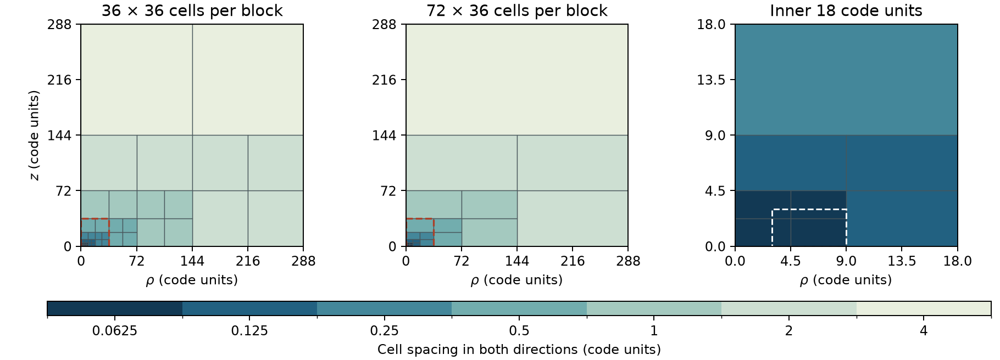

# Extending the equatorial grid to 288

The new input evolves a reflected quadrant with both outer faces at 288 code units. This is eight times the previous square domain's linear extent and 64 times its meridional area. The coordinate distance from the origin is 57.60 initial ADM masses for 0.9508 and 57.34 for 1.0600. The solver samples the existing elliptic initial data in its compactified exterior through these distances. The angular grid is 24 × 48 and the spatial and angular transport and source coupling use order four.

| Outer face | Root blocks (radial × axial) | Cells per block | Initial leaves | Active spatial cells |
|---:|---:|---:|---:|---:|
| 36 | 2 × 2 | 36 × 36 | 22 | 28,512 |
| 288 | 2 × 2 | 36 × 36 | 40 | 51,840 |
| 288 | 1 × 2 | 72 × 36 | 20 | 51,840 |
| 288 | 2 × 2 | 72 × 72 | 19 | 98,496 |
| 288, keeping exterior spacing 0.5 | 16 × 16 | 36 × 36 | 274 | 355,104 |

The default extended deck uses 36 × 36 blocks. Its root spacing is 4. Six dyadic refinements reach 0.0625. Refining around the inner region and the ring automatically builds the 2:1 transition to the exterior. The full original finest footprint, 3 ≤ ρ ≤ 9 and |z| ≤ 3, retains Δρ = Δz = 0.0625. Alignment with the larger blocks extends this spacing to 0 ≤ ρ ≤ 9 and |z| ≤ 4.5 on the 36 × 36 and 72 × 36 layouts. The existing production and bisection decks use 24 × 24 blocks.

The 36 × 36 and 72 × 36 layouts have identical cell positions and spacing everywhere initially. Merging the blocks in radial pairs halves their number. The 72 × 72 layout has one fewer leaf than 72 × 36 but adds 90% more initial active cells. The mesh audit checks whole-domain coverage, face balance, and overlap of the initial cell layouts.



The dashed red box is the old 36-unit quadrant. The white outline shows the original finest ring footprint. On the equator the new meshes have spacing 0.25 between 18 and 36 and 0.5 from 36 to 72. Projecting the last archived 1.0600 radiation output (37.135 M) onto the new *initial* hierarchy gives mean spacing 0.25 in the outer energy decile. The evolved archive reached 0.0625 there. Following that shell beyond the old outer boundary still requires a long evolution on the new mesh.

In the actual extended 1.0600 evolution, the initial axial angular momentum on extraction spheres at radii 17, 36, 72, 144 and 256 agreed with the imported ADM value to within 6e-7. The finite-radius mass decreased from 7.25764 at radius 17 to 5.17202 at radius 256, toward the elliptic ADM mass of 5.02293. The tabulated sphere measurements accompany this report.

## Four-B200 benchmark

Job 58078 ran the 1.0600 case on four physical B200s on StellarAI node sai-n02g3. Both completed 36 × 36 configurations used 361 timesteps to reach 0.09954345 initial ADM masses. Wall time includes startup, evolution, output and checkpointing.

| Outer face | Mean active blocks | Mean active spatial cells | Wall seconds | GPU-hours | Sampled peak MiB/GPU |
|---:|---:|---:|---:|---:|---:|
| 36 | 33.02 | 42,790 | 294.70 | 0.32744 | 28,856 |
| 288 | 62.03 | 80,396 | 372.65 | 0.41406 | 28,858 |

Moving both outer faces eight times farther increased GPU-hours by 26.45% over this interval. Both runs finished with a mean circumferential radius of 2.536991 initial ADM masses, differing by 4.45e-16. The block-size trials compare 72 × 36 and 72 × 72 on the same enlarged domain. The timing data file records the completed comparisons. This early interval checks the enlarged grid during initial infall.

## Reproduction

Generate and check the default deck from the solver root with the following commands. The input expects the same calibrated family file named `ring.adm` in the run directory.

```sh
python tst/unit/boltzmann/equator/layout.py /tmp/wide.in --half --extent 288 --check build/src/athena
python tst/unit/boltzmann/equator/wide_mesh.py build/src/athena /tmp/ring-mesh-audit
sbatch --ntasks-per-node=4 --gres=gpu:4 --mem=150G -t 00:25:00 tst/unit/boltzmann/equator/stellar.sh --wide
```

Use `--root-blocks 1 --block-cells 72 --axial-block-cells 36` for the radially paired alternative. All new wide-layout inputs require at least 36 cells along each block edge. The historical decks have their original block size.
