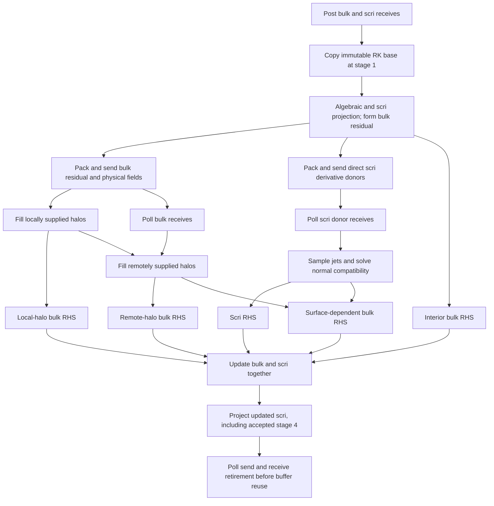

# Hyperboloidal native stage task contract

`src/z4c_hyperboloidal/tasks.hpp` queues ordinary AthenaK `NumericalRelativity`
tasks. `Driver::ExecuteTaskList` still executes `before_stagen`, `stagen`, and
`after_stagen`; no separate evolution loop or scheduler is introduced.

The module adapters in `z4c_hyperboloidal_tasks.cpp` call the actual block-local
`MappedHalo` and `SurfaceExchange` plans. Construction binds callbacks before
the problem generator initializes fields. `BuildStagePlans` must complete after
initialization and before execution. `Driver::Initialize` invokes the module's
boundary initializer after problem generation or restart restore. That hook
builds plans, projects dependent fields, exchanges current donors, fills ghosts
and solves normal compatibility through the original `TaskList` polling. It
does not advance evolved fields or reset chi-floor records. Fixed-topology
dynamic evolution requires `rk4_classical`; adaptive evolution remains rejected
until field transfer and plan rebuilding are integrated.

Per-stage dependencies:

The scri derivative plan imports independently evolved donors directly, so its
normal solve does not wait for volume ghost interpolation. Normal corrections
remain on the owning outer MeshBlock: the six-by-six tangential interpolation
used by the lift reads only that block's face. The surface-dependent bulk batch
joins normal compatibility with volume-halo completion. Complete numerical
stencil dependencies determine the four disjoint bulk batches.

Packing copies values into persistent send buffers before later ghost writes.
Incomplete receive tasks yield to other ready tasks. Send retirement and receive
retirement are independent end tasks; both must finish before Driver starts the
next stage. These tasks add no stage-wide MPI collective. This dependency graph
permits communication overlap; GPU/MPI progress and achieved overlap still need
measurement on Aurora.

Stage four also checks every accepted bulk field for finiteness, positive chi
and physical lapse, and positive metric principal minors/determinant before any
accepted state can reach diagnostics. This retains the reference driver's
accepted-state validity check; the algebraic metric projection alone cannot
detect an invalid accepted lapse or chi. The module oracle injects a stage-four
rate that produces a negative physical lapse and a separate nonfinite chi rate,
and requires immediate rejection in both cases.

`task_graph.cpp` binds this same queue function to the original `TaskList` using
delayed mock operations. It checks all sixteen empty/nonempty bulk-batch masks
under three independent arrival orders, four RK stages each: 48 cases and 192
stages. Poisoned current-stage data checks early reads; unique stage payloads
check stale reads; accepted RK states are invariant to arrival order. The test
also checks that pending sends prevent buffer reuse while receive retirement
continues. This is scheduler/dependency evidence, not a PDE or MPI correctness
claim. Actual MPI transport, whole-grid RHS, and native trajectory tests are
separate gates.

`stage_smoke.py` links the actual candidate AthenaK objects and runs one complete
cycle through `Driver::Execute`. Test hooks poison every RHS, residual, physical
ghost and point-status workspace before each stage, then verify all owned bulk
and scri values, RK updates, algebraic projection, stage clocks and untouched RHS
ghosts. The test writes every accepted bulk/scri field and every chi-floor record
in canonical native-GID order, enabling complete byte comparisons across ranks.
Two and eight ranks here are local CPU MPI processes, not Aurora nodes or GPUs.
The original one-cycle evidence used static construction followed by explicit
test setup of dynamic mode and `dt`; those results alone do not establish the
production initialization or multicycle lifecycle. `lifecycle_smoke.py` exercises
the actual executable using ordinary dynamic input for one and eight cycles,
without test callbacks or in-memory mode/timestep overrides. It checks exact
`dt` and accumulated times, independence from `cfl_number`, completion of a full
last step across a nonaligned `tlim`, and rejection of unsupported integrators,
kinematic mode, adaptive evolution and excessive relaxation timesteps. Numerical
trajectory agreement and restart continuity require their separate oracles.

The pinned reference is the spherical-policy **device** implementation. Its
bulk kernel reports the characteristic CFL but deliberately excludes this policy
from the generic `CFL > 0.4` rejection; it still rejects
`dt / min(tau, InnerTelegrapher::tau) > 0.25`. Its spherical surface evaluator also
has no timestep-dependent penalty admission check. The older host `RHS3D` path
has additional characteristic/penalty checks, so copying those checks would
change the pinned device policy. The native implementation currently follows
the device admission behavior. `Driver::Initialize` obtains the prescribed
`time/dt` in seconds from the module, and `Mesh::NewTimeStep` preserves it across
cycles without another `cfl_number` factor, a growth limiter or a shortened last
step. Ordinary Cartesian module timestep behavior is unchanged. Any adaptive
mapped-step policy requires its own validation, especially after refinement.
